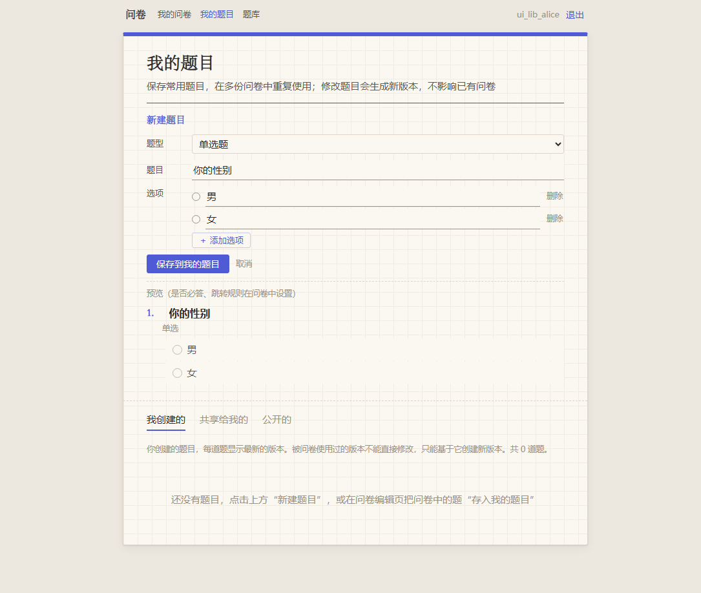
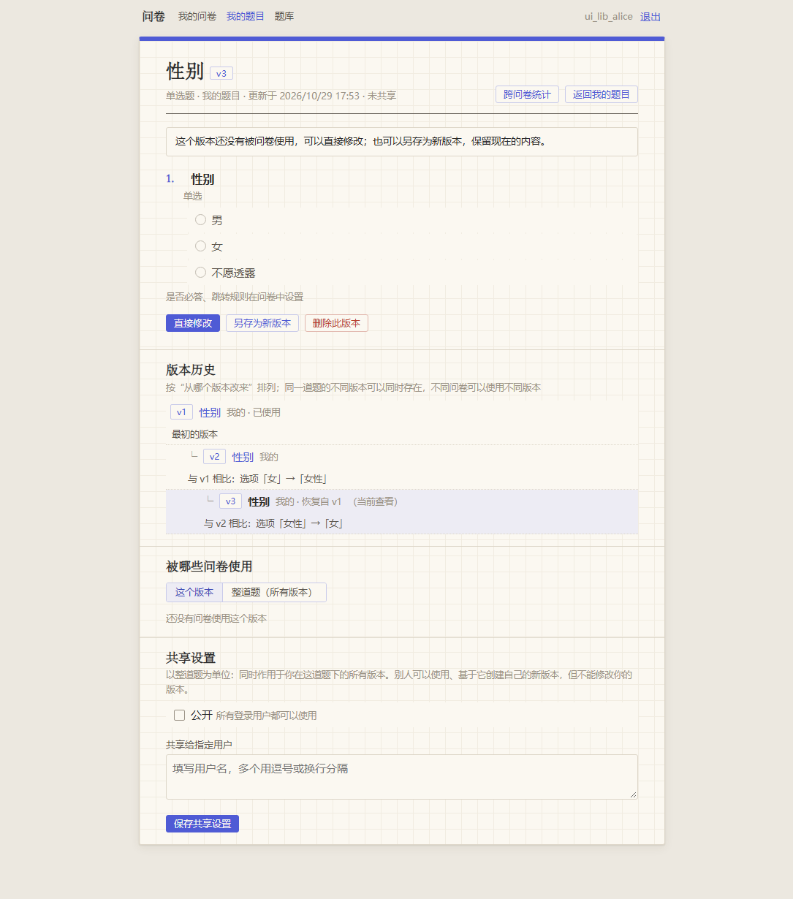
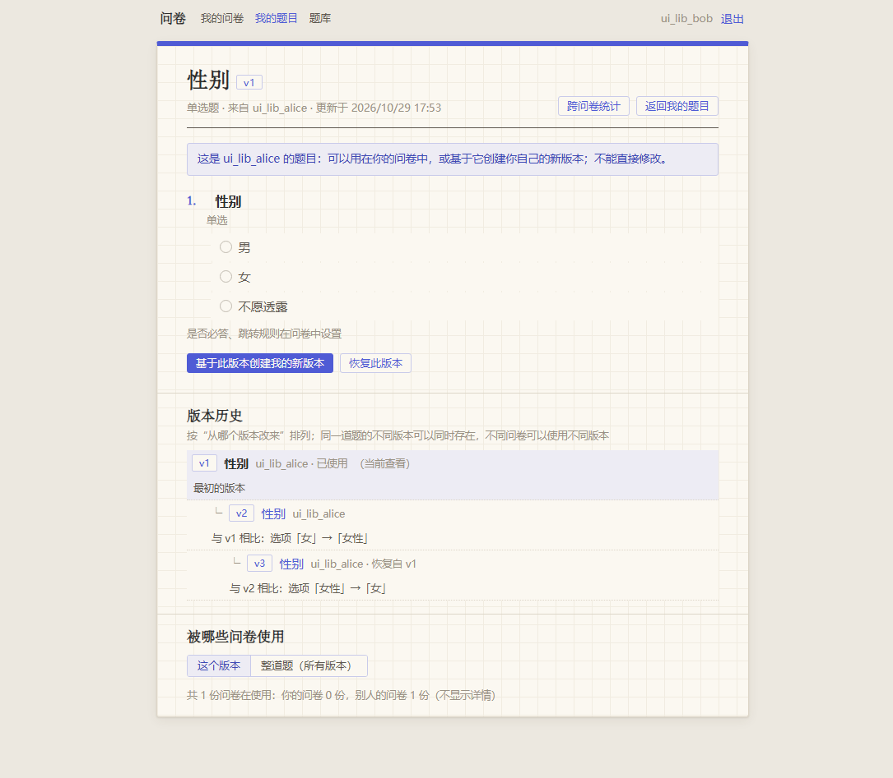
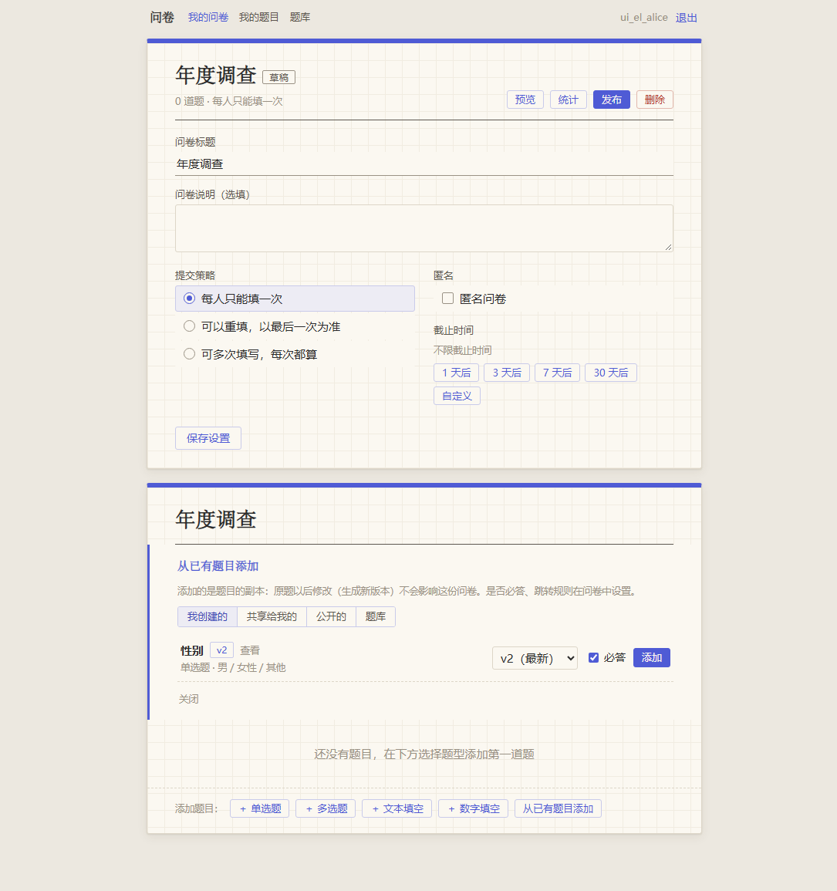
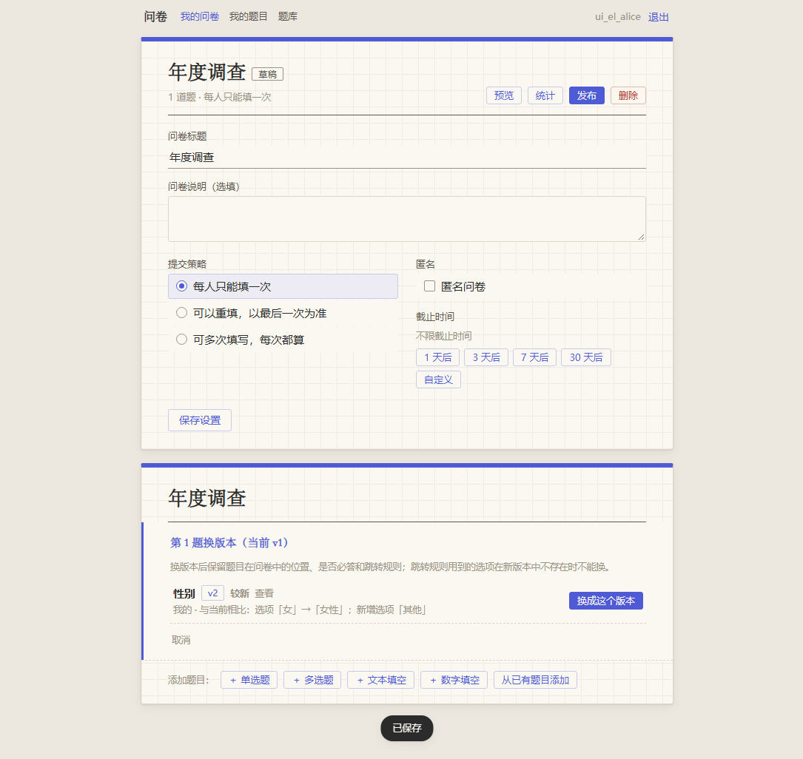
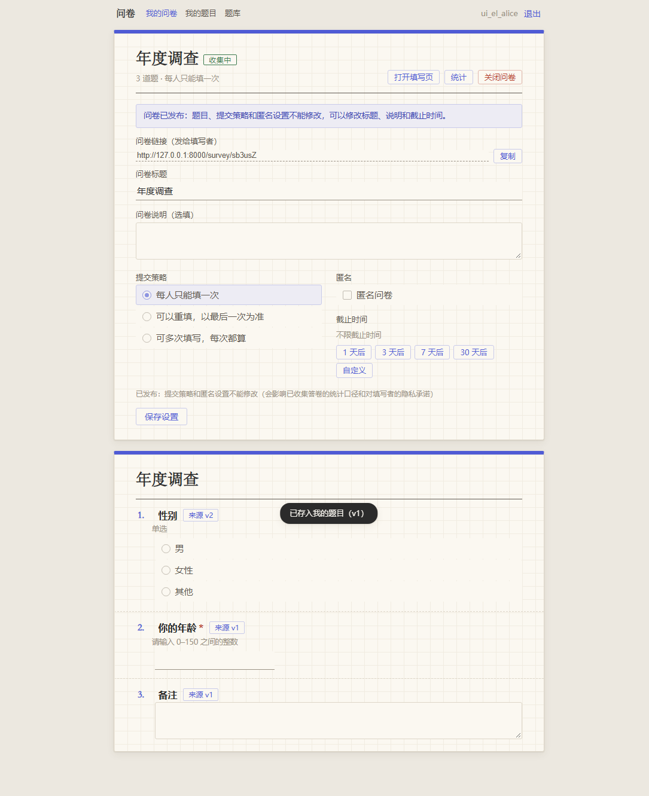
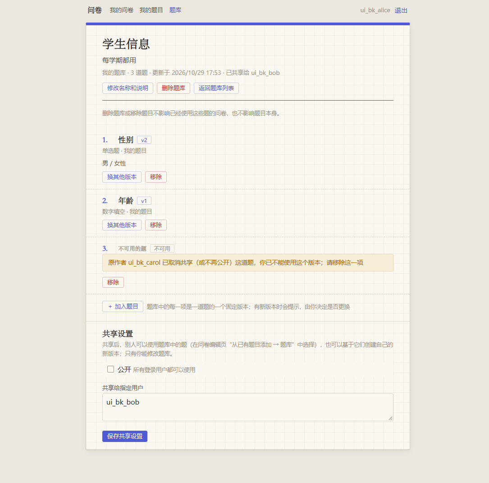
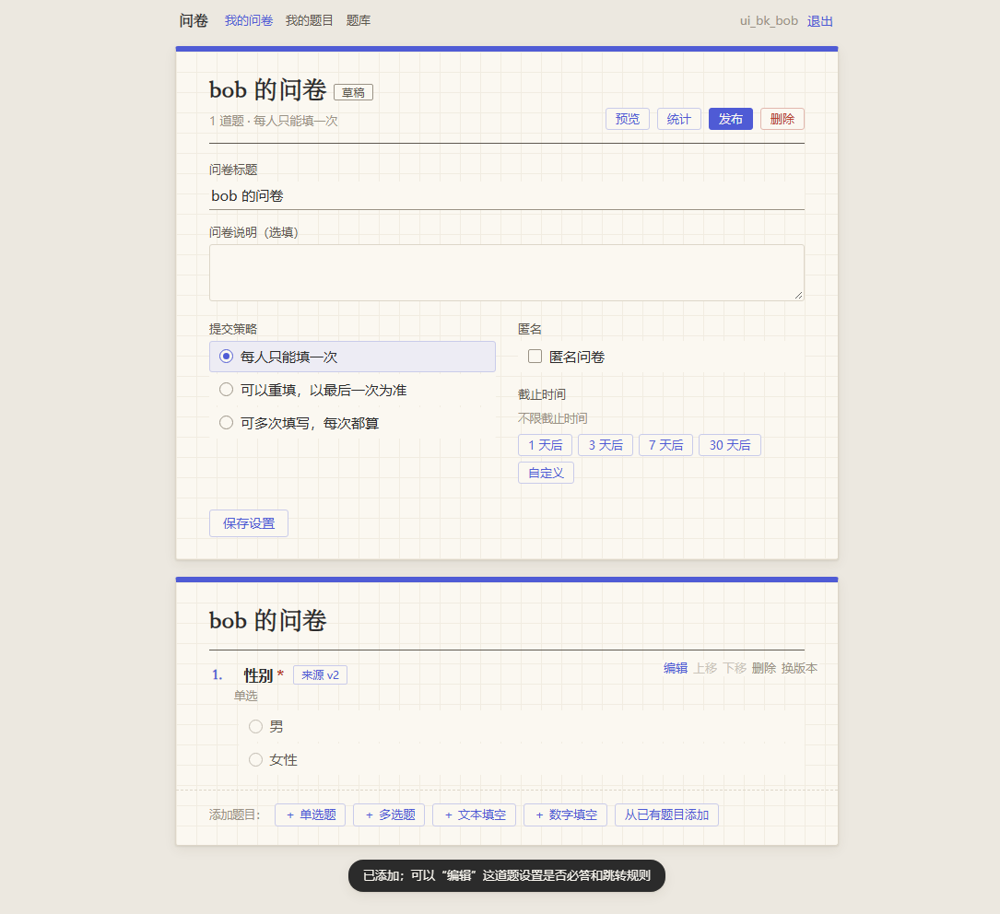
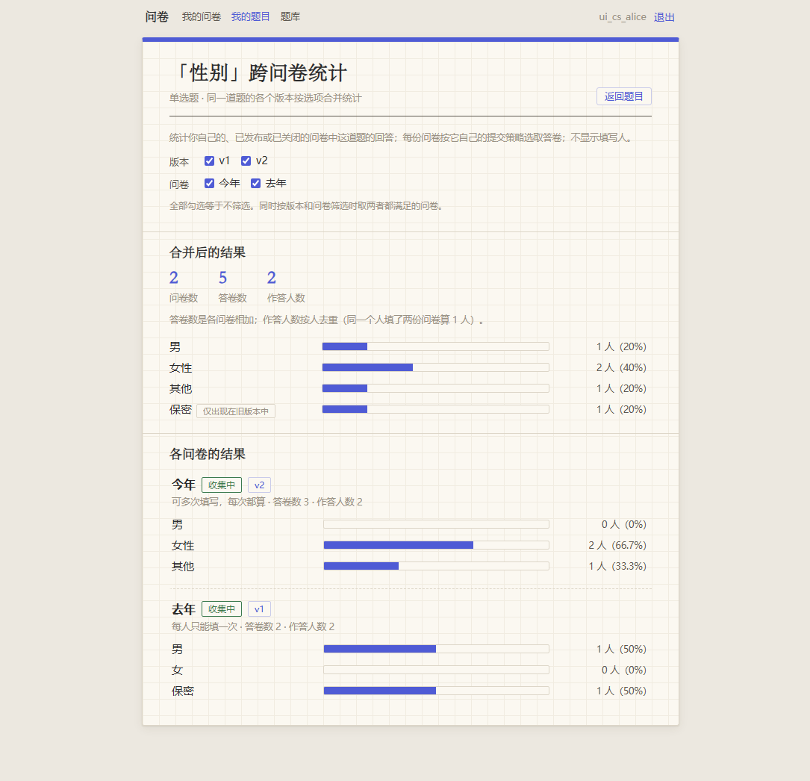
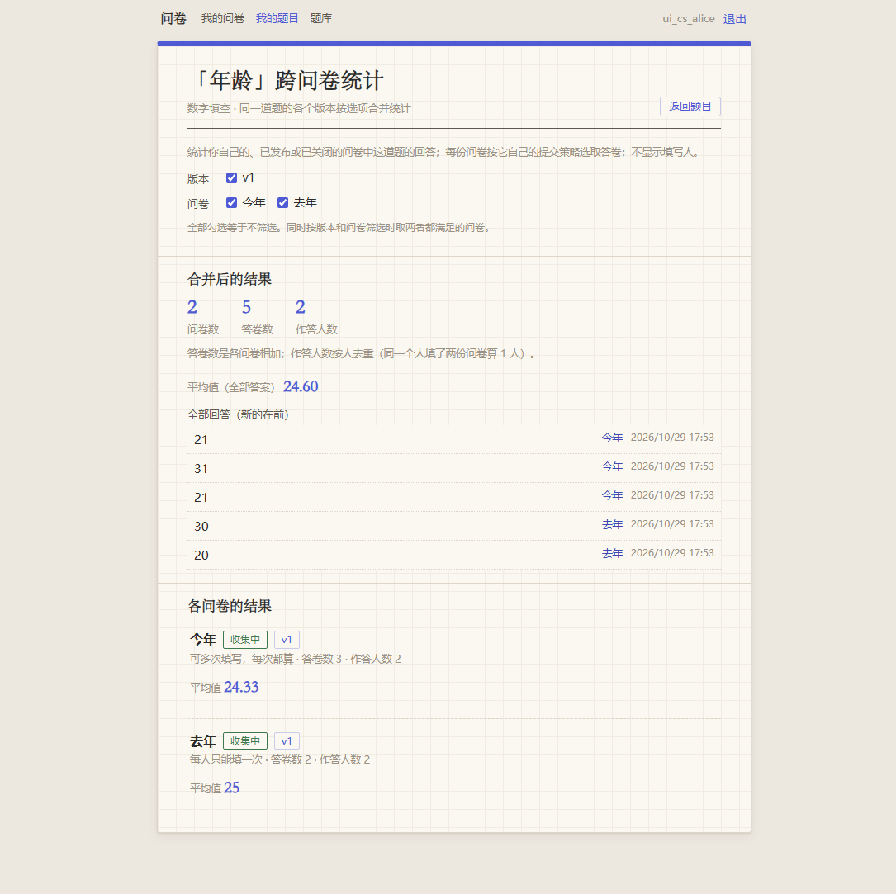

# 测试用例

> 第一阶段测试说明：测试环境、运行方法、运行记录、测试用例（步骤、输入、期望输出、实际结果）、基于本人手工创建的问卷的端到端测试、界面测试与手工测试。
> **第二阶段**的运行记录、测试用例、界面测试、兼容性验证和手工测试见文末[第二阶段](#第二阶段)（第七~十节）。
> 每条用例都对应到具体的自动测试函数（`文件::函数`），可以直接定位核对。

## 一、测试环境与运行方法

| 项目 | 版本 |
|---|---|
| 操作系统 | Windows 11 |
| Python | 3.14.2 |
| MongoDB | 8.3.11（mongosh 2.12.0） |
| FastAPI / PyMongo / Uvicorn | 0.147.0 / 4.19.0 / 0.54.0 |
| pytest / pytest-cov | 9.1.1 / 7.1.0 |
| Node.js（界面测试、前端纯函数测试） | 24.14.0 |
| Chrome（界面测试，无界面模式） | 155.0.8059.80 |

```bash
pytest                                   # 全部测试（含界面测试）
pytest -m "not ui"                       # 只跑后端测试（不需要 Node.js 和 Chrome）
pytest --cov=app --cov=scripts --cov-report=term-missing   # 代码覆盖率
```

**测试数据隔离**：
- 后端测试使用独立数据库 `survey_test`（`tests/conftest.py` 在导入应用前设置；库名不以 `_test` 结尾时直接报错，防止误清开发库）。整轮测试开始前重建、结束后删除；每个测试结束后清空各集合。
- 界面测试在空闲端口单独启动服务，使用独立数据库 `survey_ui_test`，结束后删除。
- 测试中 bcrypt 强度设为 4 以加快速度（正式运行为 12，有测试保证默认值）。

**测试分层**：

| 层次 | 内容 | 工具 |
|---|---|---|
| 纯函数单元测试 | 校验规则、跳转规则检查、路径计算、状态规则（不访问数据库） | pytest |
| 数据库测试 | `$jsonSchema` 校验、索引、部分唯一索引 | pytest + PyMongo |
| 接口测试 | 每个接口的正常与异常情况、权限、并发 | pytest + FastAPI TestClient |
| 界面测试 | 在真实页面中操作编辑、填写、统计 | Node.js 驱动无界面 Chrome（`tests/ui/`） |
| 手工测试 | 开发者按检查清单在浏览器中操作 | 浏览器 |

## 二、运行记录

**2026-10-22 21:14**，命令 `pytest --cov=app --cov=scripts`：

- **660 个测试全部通过**，0 失败，0 跳过，用时 46.1 秒。
- **代码覆盖率**：`app/` **99%**（1532 行，未覆盖 4 行）；`app/` 与 `scripts/` 合计 **88%**（1877 行，未覆盖 228 行），其中 217 行来自 `scripts/sport_survey_e2e.py`——它是对着运行中的服务手动执行的端到端测试脚本（见第四节），不在 pytest 中运行，覆盖率为 0%；不计它时为 **99%**（1660 行，未覆盖 11 行）。
- 历次运行：10-20 16:03 为 645 个全部通过（覆盖率 99%，当时还没有端到端脚本）；16:23 新增 4 个配置测试（A9）后 649 个全部通过；10-22 新增 11 个示例问卷固定链接相关测试（J4）后 660 个全部通过。
- 第 11 步在干净环境中（从仓库克隆、新建虚拟环境、完全按 README 操作）运行，同样全部通过。

| 测试文件 | 用例数 | 内容 |
|---|---|---|
| `test_auth.py` | 52 | 注册、登录、令牌、统一错误格式 |
| `test_db.py` | 29 | 集合校验规则、索引、部分唯一索引、64 位整数存储 |
| `test_surveys.py` | 74 | 问卷创建、列表、修改、删除、发布、关闭、过期；脚本指定固定链接代码 |
| `test_survey_state.py` | 27 | 问卷状态规则表（纯函数） |
| `test_question_rules.py` | 56 | 单题设置检查（纯函数） |
| `test_survey_check.py` | 93 | 跳转规则合法性检查与警告（纯函数） |
| `test_questions.py` | 55 | 题目编辑接口、编辑冲突 |
| `test_validation.py` | 72 | 答案校验（纯函数） |
| `test_jump.py` | 74 | 答题路径计算（纯函数） |
| `test_fill.py` | 46 | 填写与提交、提交策略、并发 |
| `test_stats.py` | 28 | 统计与答卷列表 |
| `test_seed_demo.py` | 11 | 示例数据脚本（含固定链接 Food26） |
| `test_edge_cases.py` | 13 | 覆盖率检查后补充的边界情况 |
| `test_pages.py` | 18 | 页面路由、静态资源、`/api/meta` |
| `test_health.py` | 8 | 健康检查、配置（含拒绝示例密钥） |
| `test_frontend_js.py` | 1 | 前端纯函数（Node.js） |
| `test_ui.py` | 3 | 界面测试：编辑页、填写页、统计页（共 30 个步骤） |
| **合计** | **660** | |

## 三、测试用例

**说明**：

- 每条用例写明**测试步骤、输入、期望输出、实际结果**，并对应到自动测试函数。同一测试点的多组输入合并为一行（参数化测试）。
- **实际结果**是上述运行（2026-10-22 21:14）中测试断言检查到的实际返回值或数据库状态。断言要求实际值与表中的值相等（或包含表中的文字），测试通过即说明实际值就是表中所列的值；断言没有检查的内容不写进实际结果。99 条全部通过。
- **水果问卷**：许多用例使用设计文档 3.4 的示例问卷（由 `tests/builders.py` 通过接口搭建）：第 1 题单选“你喜欢吃水果吗？”（喜欢/不喜欢；不喜欢 → 第 5 题）；第 2 题多选“你喜欢哪些水果？”（苹果/香蕉/西瓜/榴莲，必答 1–3 项；选了榴莲 → 第 3 题，否则 → 第 4 题）；第 3 题文本“为什么喜欢榴莲？”（选填 5–200 字）；第 4 题数字“你每周吃几次水果？”（必答 0–50 整数；0 → 结束）；第 5 题文本“其他建议”（选填）。**完整答案**指：喜欢 / [苹果, 榴莲] / “闻着臭吃着香” / 7 / “多吃水果”。
- 测试账号的默认密码为 `password123`。

### A. 账号

| 编号 | 测试点 | 测试步骤 | 输入 | 期望输出 | 实际结果 | 自动测试 |
|---|---|---|---|---|---|---|
| A1 | 注册成功 | POST `/api/auth/register`，再查数据库 | `{"username": "alice", "password": "password123"}` | 201，返回 id、username、createdAt，不含密码、不返回令牌 | 201；`username` 为 `alice`，`id` 是合法 ObjectId，有 `createdAt`；响应中没有 `password`、`passwordHash`、`accessToken`；数据库中有该用户且 `createdAt` 不为空 | `test_auth.py::test_register_success`、`test_register_does_not_return_token` |
| A2 | 密码只存哈希 | 注册后查数据库中的用户文档 | 用户名 `alice`，密码 `my-secret-pw` | `passwordHash` 以 `$2b$` 开头，文档中不含明文 | `passwordHash` ≠ 明文，以 `$2b$` 开头；整个用户文档中找不到 `my-secret-pw` | `test_auth.py::test_password_stored_as_bcrypt_hash` |
| A3 | 用户名规则 | 用不合法用户名注册 | `ab`、21 个 `a`、空字符串、3 个空格、`al ice`、`alice!`、`张三丰`、全角 `ａｌｉｃｅ` | 422，提示“长度应为 3~20 个字符”或“只能包含字母、数字和下划线” | 8 组都是 422，`code` 为 `VALIDATION_ERROR`；前 4 组 errors 含 `{"field": "username", "message": "用户名长度应为 3~20 个字符"}`，后 4 组含 `{"field": "username", "message": "用户名只能包含字母、数字和下划线"}` | `test_auth.py::test_register_invalid_usernames` |
| A4 | 用户名大小写与空格 | 注册后用大小写不同的同名再注册 | `"  Alice_01 "`；先注册 `alice`，再注册 `ALICE`、`" Alice "` | 保存为 `alice_01`；`ALICE` 视为重名，409 | `"  Alice_01 "` 注册 201，返回 `username` 为 `alice_01`；`ALICE`、`" Alice "` 都返回 409 | `test_username_stored_lowercase_and_trimmed`、`test_register_duplicate_username_case_insensitive` |
| A5 | 密码长度边界 | 用不同密码注册，成功的再登录 | `1234567`（7 字符）、`12345678`（8 字符）、8 个汉字（24 字节）、5 个汉字（15 字节）、72/73 个 `a`、24/25 个“密”、8 个空格 | 至少 8 个字符、最多 72 字节；5 个汉字（15 字节但只有 5 个字符）被拒 | 8 字符、8 个汉字、72 字节、24 个汉字、8 个空格：注册 201，登录 200；7 字符、5 个汉字、73 字节、25 个汉字：422，出错字段只有 `password` | `test_auth.py::test_register_password_length` |
| A6 | 登录失败不泄露用户名是否存在 | 注册 alice 后分别登录 | `alice` + `wrong-password`；`nobody` + `password123` | 两者都返回完全相同的 401“用户名或密码错误” | 两次都是 401，响应体完全相同：`{"code": "INVALID_CREDENTIALS", "message": "用户名或密码错误"}` | `test_login_wrong_password_and_unknown_user_same_response` |
| A7 | 令牌无效 | 带不同令牌 GET `/api/auth/me` | 有效令牌（对照）；无令牌；`Bearer not-a-jwt`、`Bearer `、`Basic YWxpY2U6cGFzcw==`；用 `attacker-secret-…` 签名的令牌；1 分钟前过期的令牌；不存在用户的令牌；缺 `sub` 的令牌；`sub` 为 `not-an-object-id` | 401：`NOT_AUTHENTICATED` / `INVALID_TOKEN` / `TOKEN_EXPIRED` | 有效令牌 200，`username` 为 `alice`；无令牌 401 `{"code": "NOT_AUTHENTICATED", "message": "请先登录"}`，响应头 `WWW-Authenticate: Bearer`；3 种格式错误 401（`INVALID_TOKEN` 或 `NOT_AUTHENTICATED`）；他人密钥、用户不存在、缺 sub、sub 不合法均 401 `INVALID_TOKEN`；过期 401 `{"code": "TOKEN_EXPIRED", "message": "登录已过期，请重新登录"}` | `test_auth.py::test_me_*`、`test_edge_cases.py::test_token_with_malformed_subject` |
| A8 | 统一错误格式 | 发送各种不合法请求 | 注册时只有 username；`username` 为 `123`；请求体 `{not json`；第 2 行缺值的 JSON；GBK 编码的请求体；GET `/api/no-such-route`；GET `/api/auth/login`；模拟服务内部抛出含 `secret detail` 的异常 | 统一为 `{code, message, errors?}` 的中文提示；JSON 错误位置写在 message 中；500 不暴露内部细节 | 缺字段 422 `{"code": "VALIDATION_ERROR", "message": "提交内容不合法", "errors": [{"field": "password", "message": "缺少必填字段"}]}`；类型错误 errors 为 `[{"field": "username", "message": "应为字符串"}]`；`{not json` → `[{"field": "body", "message": "请求体不是合法的 JSON（第 2 个字符附近）"}]`；第 2 行缺值 → “（第 36 个字符附近）”；GBK 400 `{"code": "BAD_REQUEST", "message": "请求体无法解析，请使用 UTF-8 编码的 JSON"}`；未知路径 404 `{"code": "NOT_FOUND", "message": "请求的资源不存在"}`；错误方法 405 `METHOD_NOT_ALLOWED`；内部异常 500 `{"code": "INTERNAL_ERROR", "message": "服务器内部错误"}`，响应中没有 `secret` | `test_auth.py::test_*_unified_error_format`、`test_invalid_json_*`、`test_edge_cases.py::test_unexpected_error_returns_unified_500` |
| A9 | 拒绝不安全的 JWT 密钥 | 用不同的 `JWT_SECRET` 加载配置 | `too-short`；`.env.example` 中的示例值，以及前后各加 2 个空格的示例值；`my-real-server-key-20`（真实但过短） | 拒绝启动并提示生成命令；示例值单独提示“仍是 .env.example 中的示例值”；报错信息中不出现输入的密钥；`.env.example` 的示例值与程序拒绝的列表一致 | `too-short`：抛出 ValidationError，信息含“至少 32 个字符”和 `secrets.token_urlsafe`；示例值（两种写法）：信息含“仍是 .env.example 中的示例值”和 `secrets.token_urlsafe`；`my-real-server-key-20` 没有出现在报错信息中；`.env.example` 的示例值在 `EXAMPLE_JWT_SECRETS` 中 | `test_health.py::test_short_jwt_secret_rejected`、`test_example_jwt_secret_rejected`、`test_config_errors_do_not_echo_secret`、`test_example_secret_list_matches_env_example` |

### B. 问卷管理与状态

| 编号 | 测试点 | 测试步骤 | 输入 | 期望输出 | 实际结果 | 自动测试 |
|---|---|---|---|---|---|---|
| B1 | 创建问卷 | alice POST `/api/surveys`，再查数据库 | `{"title": "水果偏好调查", "description": "了解大家吃水果的习惯", "allowAnonymous": true, "submissionPolicy": "latest", "deadline": "2099-11-30T23:59:59+08:00"}` | 201，草稿；截止时间统一存 UTC（`15:59:59Z`）；链接不存库 | 201；`status` 为 `draft`，`isExpired` 为 false，`version` 为 1，`questions` 为空，`publishedAt`、`closedAt` 为 null；`settings.deadline` 为 `2099-11-30T15:59:59Z`；数据库中 `ownerId` 是 alice 的 id，截止时间存为 UTC 2099-11-30 15:59:59，文档中没有 `url` 字段 | `test_surveys.py::test_create_survey` |
| B2 | 默认值与 shortCode | 只填标题创建；连续创建 20 份；模拟随机生成的代码与已有代码重复 | `{"title": "只有标题"}`；20 次创建；生成器依次返回 [已有代码, 已有代码, `Zz9Yy8`] | 说明为空、不匿名、`once`；shortCode 为 6 位字母数字且互不重复；重复时自动重试 | `description` 为 `""`，`settings` 为 `{"allowAnonymous": false, "submissionPolicy": "once", "deadline": null}`；shortCode 匹配 `[A-Za-z0-9]{6}`，`url` 为 `PUBLIC_BASE_URL` + `/survey/<shortCode>`；20 个 shortCode 互不相同；重复 2 次后得到 `Zz9Yy8` | `test_create_defaults`、`test_short_code_and_url`、`test_short_codes_are_unique`、`test_short_code_collision_retries` |
| B3 | 字段校验 | 用不合法字段创建 | 空标题、3 个空格的标题、101 字标题、1001 字说明、截止 `2020-01-01T00:00:00Z`、无时区 `2099-11-30T23:59:59`、`"submissionPolicy": "daily"`、`"allowAnonymous": "yes"` 或 `1`、`"deadline": "下周五"` | 422，指出字段和原因 | 均 422；errors 分别含 `{"field": "title", "message": "标题不能为空"}`（空标题、空格标题）、`{"field": "title", "message": "标题最多 100 个字符"}`、`{"field": "description", "message": "说明最多 1000 个字符"}`、`{"field": "deadline", "message": "截止时间必须晚于当前时间"}`；无时区时第一条错误字段为 `deadline`，信息含“时区”；`daily`、`"yes"`、`1`、`"下周五"` 的 errors 分别含 `submissionPolicy`、`allowAnonymous`、`allowAnonymous`、`deadline` | `test_create_invalid_fields`、`test_create_invalid_types`、`test_create_deadline_without_timezone_rejected` |
| B4 | 只能看到自己的问卷 | alice 依次建 A1、A2，bob 建 B1；给 alice 的问卷直接加 1 道题；alice GET `/api/surveys` | 问卷标题 `A1`、`A2`（alice）、`B1`（bob） | 只含 alice 的问卷，新的在前，含题目数、答卷数 | alice 的列表 id 顺序为 [A2, A1]，不含 B1；列表项不含 `questions`；加题后 `questionCount` 为 1（答卷数 `responseCount` 的核对见 H6） | `test_list_only_my_surveys_newest_first`、`test_list_question_count` |
| B5 | 访问别人的问卷 | bob 对 alice 的问卷（有 1 道题）和一个随机不存在的 id 分别操作；alice 再查看问卷 | bob 的令牌；GET、PATCH `{"title": "改"}`、DELETE、POST `/publish`、POST `/close` | 与不存在的问卷返回完全相同的 404，数据不变 | 5 种操作对两个 id 都返回 404，响应体都是 `{"code": "SURVEY_NOT_FOUND", "message": "问卷不存在"}`；alice 再查看，问卷与操作前完全相同 | `test_surveys.py::test_cannot_access_others_survey` |
| B6 | 各状态可改字段 | 已发布、已关闭的问卷分别 PATCH | 已发布：标题“新标题”、说明“新说明”、截止 `2099-01-01T00:00:00+08:00`；`submissionPolicy: all` + 改标题；`allowAnonymous: true` + 改标题。已关闭：5 个字段各改一次 | 发布后只能改标题、说明、截止时间；匿名和策略 409 `FIELD_LOCKED`（说明原因）；关闭后全部拒绝；被拒时整个请求不生效 | 允许的字段 200，`deadline` 为 `2098-12-31T16:00:00Z`；改策略、匿名：409，`code` 为 `FIELD_LOCKED`，errors 只有该字段，message 分别含“统计口径”“隐私承诺”，标题仍为原值；已关闭 5 次都是 409 `FIELD_LOCKED`，message 以“问卷已关闭，不能修改”开头 | `test_update_published_allowed_fields`、`test_update_published_locked_fields`、`test_update_closed_rejected` |
| B7 | 相同值不算修改 | 已发布问卷（latest、匿名）提交与当前相同的锁定字段 | `{"title": "新标题", "submissionPolicy": "latest", "allowAnonymous": true}` | 200，标题已修改 | 200，`title` 为“新标题” | `test_update_same_value_on_locked_field_is_ok` |
| B8 | 发布条件 | 不同情况下 POST `/publish` | 无题目的草稿；截止时间改为 2020-01-01 的草稿；已发布再发布；已关闭再发布 | 422 `NO_QUESTIONS`；422 截止时间；409 `INVALID_STATUS` | 无题目 422 `{"code": "NO_QUESTIONS", "message": "问卷至少需要 1 道题才能发布"}`；截止已过 422，第一条错误字段为 `deadline`；已发布 409 `{"code": "INVALID_STATUS", "message": "只有草稿的问卷可以发布（当前状态：已发布）"}`；已关闭 409，message 为“…（当前状态：已关闭）” | `test_publish_without_questions_rejected`、`test_publish_with_past_deadline_rejected`、`test_publish_twice_or_after_close_rejected` |
| B9 | 关闭与删除 | POST `/close`、DELETE | 草稿关闭；草稿删除；已发布、已关闭的问卷删除 | 草稿不能关闭（409）；只能删除草稿 | 草稿关闭 409，message 为“只有已发布的问卷可以关闭（当前状态：草稿）”；删除草稿 204，数据库中已没有该文档，再查看 404；删除已发布/已关闭的问卷 409 `INVALID_STATUS`，文档仍在 | `test_close_draft_rejected`、`test_delete_draft`、`test_delete_non_draft_rejected` |
| B10 | 过期与延长 | 已发布问卷的截止时间直接改为过去，查看详情和列表；再 PATCH 截止时间 | 截止时间 2020-01-01；新截止时间为 30 天后或 `null` | `isExpired` 为 true，状态仍为 published；延长后恢复为 false | 详情 `status` 为 `published`、`isExpired` 为 true，列表中 `isExpired` 也为 true；两种延长方式都 200，`isExpired` 为 false，`status` 为 `published` | `test_expired_survey`、`test_extend_expired_survey_resumes` |
| B11 | 并发发布 | 8 个线程同时调用发布 | 1 份有 1 道题的草稿 | 只有 1 个成功，其余 `INVALID_STATUS` | 8 个结果中成功 1 个，其余都是 `INVALID_STATUS` | `test_surveys.py::test_concurrent_publish_only_one_succeeds` |
| B12 | 状态规则表 | 纯函数 `can(状态, 操作)`、`locked_fields(状态)` | 3 种状态（另加未知状态）× 4 种操作（发布、关闭、删除、改题目）；5 个设置字段 | 与设计文档 6.4 的表格逐格一致 | 13 组 `can` 结果与表一致（只有草稿可发布/删除/改题目，只有已发布可关闭，未知状态一律 false）；锁定字段：草稿 `[]`，已发布 `[allowAnonymous, submissionPolicy]`，已关闭 5 个字段全部锁定 | `test_survey_state.py::test_can`、`test_locked_fields` |

### C. 题目与题目设置校验

| 编号 | 测试点 | 测试步骤 | 输入 | 期望输出 | 实际结果 | 自动测试 |
|---|---|---|---|---|---|---|
| C1 | 添加题目 | POST `/api/surveys/{id}/questions`；再连续添加 5 道 | 单选题“你喜欢吃水果吗？”，选项 喜欢/不喜欢，必答 | 201；题目 id `q_`+6 位、选项 id `o_`+6 位，问卷内不重复 | 201；题目 id 匹配 `q_[a-z0-9]{6}`，选项 id 匹配 `o_[a-z0-9]{6}`；选项文字为 [喜欢, 不喜欢]，`validation` 为 `{"required": true}`，没有 `logic`；5 道题共 15 个 id 互不相同 | `test_questions.py::test_add_question`、`test_ids_unique_across_survey` |
| C2 | 插入位置 | 依次添加并指定 position | 先加 A、B，再加“开头”(position=1)、“第三”(3)、“末尾”(5)；只有 1 题时 position=0、3、-1 | 插入到指定位置；越界时 422 | 顺序为 [开头, A, 第三, B, 末尾]；越界 3 组都是 422，errors 为 `[{"field": "position", "message": "position 应为 1~2"}]` | `test_add_appends_by_default_and_supports_position`、`test_add_invalid_position` |
| C3 | 添加时不接受跳转规则 | 添加题目时带 logic | 单选题 + `"logic": {"rules": [], "defaultNext": null}` | 422“添加题目时不能设置跳转规则，请添加后通过修改题目设置” | 422，errors 为 `[{"field": "logic", "message": "添加题目时不能设置跳转规则，请添加后通过修改题目设置"}]` | `test_questions.py::test_add_with_logic_rejected` |
| C4 | 多选数量设置 | 检查单题设置（4 个选项的多选题） | minSelect 3 + maxSelect 2、maxSelect 5、minSelect 5、minSelect 0、maxSelect -1、minSelect 1.5、`true`、`"2"`；“必须选 2 项”（min=max=2）等 13 种合法设置 | 拒绝并指出字段；“必须选 2 项”（min=max=2）合法 | 8 组不合法设置的问题列表分别含 `validation.minSelect` 或 `validation.maxSelect`；13 种合法设置的问题列表都为空 | `test_question_rules.py::test_multiple_choice_select_counts`、`test_valid_settings` |
| C5 | 文本、数字设置 | 检查单题设置 | 文本：minLength 10 + maxLength 5、minLength -1、maxLength 0、10001、2.5、`true`、minLength `"3"`；数字：min 10 + max 0、min `"0"`、max `true`、integerOnly `"yes"`、`1`；合法：年龄 0–120 整数、手机号整数等 | 拒绝；年龄 0–120 整数、手机号整数等合法 | 7 组文本、5 组数字的问题列表分别含对应字段（`validation.minLength` / `maxLength` / `min` / `max` / `integerOnly`）；合法设置的问题列表为空 | `test_text_lengths`、`test_number_range`、`test_valid_settings` |
| C6 | 字段与题型不匹配 | 检查单题设置 | 单选带 minSelect；多选带 minLength；文本带 min、integerOnly；数字带 minLength、maxSelect、pattern；文本、数字题带选项 `[A]` | 直接拒绝，不静默忽略 | 7 组分别报 `validation.<该字段>`；文本、数字题带选项时只报 `options`，信息含“没有选项” | `test_field_not_matching_type_rejected`、`test_non_choice_cannot_have_options` |
| C7 | 选项规则 | 检查单题设置 | 选项为空数组或不传；50 个、51 个选项；选项 [苹果, 空文字, 101 个字, 苹果]；100 个字的选项 | 拒绝 | 无选项只报 `options`；50 个合法、51 个报 `options`；第三组报 `options[1].text`、`options[2].text`、`options[3].text`，第三条信息含“重复”；100 个字合法 | `test_choice_requires_options`、`test_option_count_limit`、`test_option_text_rules` |
| C8 | 修改选项时 id 稳定 | 第 1 题加规则后修改选项文字；另一题修改时新增选项 | 规则 `eq 不喜欢 → END`；选项改为 [非常喜欢, 一点也不喜欢]（保留原 id）；新增选项 `{"text": "一般"}`（不带 id） | 选项 id 不变，引用它的规则仍有效；新增选项获得新 id | 选项 id 不变、文字已更新，`logic` 与修改前完全相同；原 2 个选项 id 不变，新选项 id 匹配 `o_[a-z0-9]{6}` 且与原有 id 不同 | `test_option_ids_stable_when_renaming`、`test_add_option_in_update_gets_new_id` |
| C9 | 发布后不能改题目 | 有 1 道文本题的问卷发布（或发布后再关闭），然后修改题目 | 添加题目、修改题目、删除题目、调整顺序 4 种操作 × 已发布/已关闭 | 409“问卷已发布，不能修改题目” | 8 种组合都是 409；已发布为 `{"code": "INVALID_STATUS", "message": "问卷已发布，不能修改题目"}`，已关闭为“问卷已关闭，不能修改题目” | `test_questions.py::test_cannot_edit_after_publish` |
| C10 | 编辑冲突 | 带过期的 `expectedUpdatedAt` 添加题目；8 线程同时添加；固定当前时间后连续添加 2 题 | 创建问卷时的 `updatedAt`（之后已有一次保存）；8 道文本题“题0”~“题7”；时间固定为 2026-10-19 12:00 UTC | 409 `EDIT_CONFLICT`；并发添加不丢失修改；同一毫秒内 updatedAt 仍严格递增 | 409 `{"code": "EDIT_CONFLICT", "message": "问卷已被修改，请刷新后重试"}`；并发时成功次数 = 数据库中的题目数（≥1），其余结果只可能是 `EDIT_CONFLICT`；两次 `updatedAt` 满足 固定时间 < 第 1 次 < 第 2 次 | `test_expected_updated_at_stale`、`test_concurrent_edits_do_not_lose_updates`、`test_updated_at_strictly_increases` |

### D. 跳转规则的合法性检查（保存时）

| 编号 | 测试点 | 测试步骤 | 输入 | 期望输出 | 实际结果 | 自动测试 |
|---|---|---|---|---|---|---|
| D1 | 13 种运算符的合法值 | 整体检查 | 单选 `eq o_a`、`in [o_a, o_b]`；多选 `contains`、`containsAny`、`containsAll`、`equals`；数字 `eq 3`、`ne 3`、`gt 3`、`gte 3.5`、`lt -2`、`lte 0`、`between [1, 5]`、`between [5, 5]` | 无错误 | 14 组的错误列表都为空 | `test_survey_check.py::test_valid_operator_values` |
| D2 | 运算符与题型不匹配 | 整体检查 | 单选用 `contains`、`gt`；多选用 `eq`、`in`；数字用 `contains`、`like` | 拒绝，指出运算符 | 6 组都只有 1 个错误，字段为 `logic.rules[0].when.op`，信息中含该运算符名 | `test_operator_must_match_type` |
| D3 | 条件值不合法 | 整体检查 | 不存在的选项、单选 `eq` 给数组、`in []`、`in` 给字符串、重复选项、别的题的选项、`containsAll []`、`equals` 中混入数字、`"3"`、`true`、`null`、`between [5, 1]`、`[1]`、`[1, 2, 3]`、`3`、`[1, "5"]` 等 17 种 | 拒绝，字段为 `logic.rules[0].when.value` | 17 组都只有 1 个错误，字段为 `logic.rules[0].when.value`；引用另一题选项时错误的 `questionId` 为本题，信息含“不是本题的选项” | `test_invalid_values`、`test_option_from_other_question_rejected` |
| D4 | 文本题不支持跳转 | 整体检查 | 文本题带 `{"rules": [], "defaultNext": null}` | 拒绝 | 第一个错误的字段为 `logic`，信息含“不支持跳转” | `test_text_question_cannot_have_logic` |
| D5 | 往前跳被拒绝 | 整体检查 | 问卷 [文本 q1, 单选 q2, 文本 q3]：q2 规则跳到 q1；跳到 q2 自己；q2 默认去向为 q1 | “第 2 题第 1 条规则：只能跳转到后面的题目或 END（目标是第 1 题）” | 只有 1 个错误，字段为 `logic.rules[0].goto`，信息分别为“第 2 题第 1 条规则：只能跳转到后面的题目或 END（目标是第 1 题）”和“…（目标是本题自己）”；默认去向往前：字段 `logic.defaultNext`，信息含“第 2 题默认去向” | `test_backward_or_self_jump_rejected`、`test_default_next_backward_rejected` |
| D6 | 调整顺序后变成往前跳 | 整体检查；通过接口调整题目顺序 | 第 1 题规则跳到第 3 题，把第 3 题移到最前（顺序 [q3, q1, q2]） | 422，顺序保持不变 | 原顺序检查无错误；调整后错误信息为“第 2 题第 1 条规则：只能跳转到后面的题目或 END（目标是第 1 题）”；接口返回 422 和同样的信息，数据库中题目顺序仍为 [q1, q2, q3] | `test_reorder_turns_forward_jump_into_backward`、`test_questions.py::test_reorder_causing_backward_jump_rejected` |
| D7 | 删除被引用的题目或选项 | 删除题目；修改题目时去掉被规则引用的选项 | 第 1 题“你喜欢吃水果吗？”规则 `eq 喜欢 → 第 2 题`，然后删除第 2 题；第 1 题规则 `eq 不喜欢 → END`，然后把选项改为只剩“喜欢” | 409 `QUESTION_REFERENCED`“第 1 题「…」的第 1 条规则跳转到这道题”；422 指出哪条规则 | 删除题目 409，`code` 为 `QUESTION_REFERENCED`，message 为“第 1 题「你喜欢吃水果吗？」的第 1 条规则跳转到这道题，请先修改该规则”，数据库中仍有 2 道题；删除选项 422，字段 `logic.rules[0].when.value`，信息为“第 1 题第 1 条规则：引用的选项 o_xxxxxx 不是本题的选项（可能已被删除），请先修改该规则”，数据库中选项仍为 2 个 | `test_delete_referenced_question_rejected`、`test_delete_option_referenced_by_rule_rejected` |
| D8 | 重叠警告 | 整体检查 | 单选 [`in [A, B] → q2`, `eq B → END`]；数字 8 组规则对（如 `gt 10` 与 `gte 18`、`lt 18` 与 `gte 18`）；整数题与非整数题的 `gt 10` 与 `lt 11`；多选 [`containsAll [1, 2]`, `contains 1`] | 单选、数字重叠给警告但允许保存；整数题交集无整数时不警告；多选不警告 | 单选：可以保存，1 条警告，字段 `logic.rules[1]`，信息含“第 1 条和第 2 条规则都包含选项「选项o_b」”；数字：`gt 10`/`gte 18`、`lte 18`/`gte 18`、`between [0,10]`/`[10,20]`、`eq 5`/`ne 6`、`ne 5`/`ne 6` 有“有重叠”警告，`lt 18`/`gte 18`、`[0,10]`/`[11,20]`、`eq 5`/`ne 5` 没有，8 组都可以保存；`gt 10`/`lt 11` 非整数题有警告，整数题无警告；多选警告列表为空 | `test_single_choice_overlap_warning`、`test_number_overlap_warning`、`test_number_overlap_ignored_when_no_integer_in_common`、`test_multiple_choice_overlap_not_warned` |
| D9 | 永远不会成立的规则、永远不会显示的题 | 整体检查 | 数字 8 组（如 0–120 的题用 `gt 120`、整数题 `eq 2.5`）；多选 6 组（如最多选 2 项却 `containsAll` 3 项）；第 1 题规则和默认去向都跳到第 3 题；不可达的题再跳到后面的题 | 警告“永远不会成立”“在任何情况下都不会被显示” | 有“永远不会成立”警告：`gt 120`（0–120）、`lt 0`（min 0）、`between [200, 300]`（max 150）、整数题 `eq 2.5`、整数题 `between [2.1, 2.9]`、`ne 5`（min=max=5）、`equals [1]`（至少 2 项）、`equals` 4 项（最多 3 项）、`containsAll` 3 项（最多 2 项）；没有警告：`gte 120`、非整数题 `eq 2.5`、`equals` 2 项（必须 2 项）、`containsAll` 2 项（最多 2 项）、`containsAny` 3 项（最多 1 项）；不可达：警告为 [第 2 题：“第 2 题在任何情况下都不会被显示（前面的跳转都绕过了它）”]；链式不可达：警告题目为 [q2, q3]；以上都可以保存 | `test_number_rule_never_matches`、`test_multiple_choice_rule_never_matches`、`test_unreachable_question_warning`、`test_unreachable_chain` |
| D10 | 设计文档示例问卷 | 整体检查；通过接口搭建并发布 | 设计文档 3.4 的水果问卷 | 无错误、无警告，可以发布 | 错误和警告列表都为空；接口搭建后 `warnings` 为空，发布 200，`status` 为 `published`，题目与发布前一致 | `test_design_example_passes_without_warnings`、`test_questions.py::test_build_design_example_and_publish` |

### E. 答案校验

| 编号 | 测试点 | 测试步骤 | 输入 | 期望输出 | 实际结果 | 自动测试 |
|---|---|---|---|---|---|---|
| E1 | 未作答的判定 | 校验（同一组答案分别对必答题和选填题） | 单选 `null`；多选 `null`、`[]`；文本 `null`、`""`、`"   \n\t "`；数字 `null` | 必答题“此题为必答题”；选填题视为未作答 | 7 组：必答时为未作答、错误“此题为必答题”；选填时为未作答、没有错误 | `test_validation.py::test_blank_is_unanswered` |
| E2 | 选填题作答后必须合法 | 校验 | 选填文本（至少 5 字）填“太短”；选填数字（最大 10）填 11；选填多选（至少 2 项）选 1 项 | “至少 5 个字（当前 2 个）” | 分别为“至少 5 个字（当前 2 个）”“不能大于 10”“至少选择 2 项（当前选了 1 项）” | `test_optional_but_answered_must_be_valid` |
| E3 | 单选 | 校验 | `"o_x"`（不是本题的选项）、`["o_a"]`、`1`、`true`；选填单选题填 `""` | “选择的不是本题的选项”/“应选择一个选项” | `"o_x"` →“选择的不是本题的选项”；数组、数字、布尔 →“应选择一个选项”；`""` →“选择的不是本题的选项” | `test_single_invalid`、`test_single_empty_string_is_not_unanswered` |
| E4 | 多选数量 | 校验 | 至少 2 项选 1 项；最多 3 项选 4 项；必须 2 项选 1 项或 3 项；`["o_a", "o_a"]`；含 `o_x`；`"o_a"`；`["o_a", 1]`；5 组边界合法值 | 对应提示，如“必须选择 2 项（当前选了 1 项）” | “至少选择 2 项（当前选了 1 项）”；“最多选择 3 项（当前选了 4 项）”；“必须选择 2 项（当前选了 1 项）”“必须选择 2 项（当前选了 3 项）”；“选项不能重复”；“包含不是本题的选项”；后两组都是“应为选项 id 组成的数组”；5 组边界值（至少 2 选 2、最多 3 选 3、必须 2 选 2、无限制选 1 项或全选）都通过 | `test_multi_count_limits`、`test_multi_invalid`、`test_multi_count_boundaries_ok` |
| E5 | 多选按选项顺序保存 | 校验 | 先选 C 再选 A：`["o_c", "o_a"]` | 保存为 `[A, C]` | 保存值为 `["o_a", "o_c"]` | `test_multi_saved_in_option_order` |
| E6 | 文本字数 | 校验 | 2–4 字的题：`你好`、`ab`、`" ab "`、`a`、`abcd`、`abcde`、`闻着臭吃着`；最多 1 字的题：`👍🏻`（带肤色）、`👍` | 去首尾空白后按 Unicode 字符计数；汉字算 1 个；emoji 可能算多个 | `你好`、`ab`、`" ab "`、`abcd` 无错误；`a` →“至少 2 个字（当前 1 个）”；`abcde`、`闻着臭吃着` →“最多 4 个字（当前 5 个）”；`👍🏻` →“最多 1 个字（当前 2 个）”；`👍` 通过并原样保存 | `test_text_length_boundaries`、`test_text_length_counts_unicode_code_points` |
| E7 | 数字类型 | 校验 | `"7"`、`""`、`true`、`false`、`[7]`、`{"v": 7}`；JSON 解析得到的 NaN、Infinity、-Infinity | “应填写数字” | 9 组都是“应填写数字” | `test_number_must_be_json_number`、`test_number_rejects_nan_and_infinity` |
| E8 | 年龄 0–120 整数（需求原文） | 校验 | 0、120、-1、121、0.0、119.5；只允许整数的题填 3.0 | -1“不能小于 0”；121“不能大于 120”；119.5“必须为整数”；`3.0` 存为 `3` | 0、120、0.0 无错误；-1 →“不能小于 0”；121 →“不能大于 120”；119.5 →“必须为整数”；3.0 保存为整数 3（类型为 int） | `test_number_age_example`、`test_integer_only_converts_float` |
| E9 | 手机号与 64 位整数范围 | 校验（integerOnly 为 true、false 各一遍） | 13812345678；2⁶³−1、−2⁶³、2⁶³、−2⁶³−1、10²⁰ | 手机号合法；超出 64 位范围时提示“数值超出允许范围”（不论是否 integerOnly） | 手机号原样保存；2⁶³−1、−2⁶³ 无错误、保存原值；2⁶³、−2⁶³−1、10²⁰ 的错误以“数值超出允许范围”开头；两种 integerOnly 设置结果相同 | `test_phone_number_example`、`test_int64_range` |

### F. 跳转路径计算

| 编号 | 测试点 | 测试步骤 | 输入 | 期望输出 | 实际结果 | 自动测试 |
|---|---|---|---|---|---|---|
| F1 | 13 种运算符判断 | 纯函数 `evaluate(题型, 运算符, 条件值, 答案)` | 30 组（含 between 两端、equals 不看顺序、`3` 等于 `3.0`） | 成立/不成立正确 | 30 组结果全部与期望一致，例如 `equals [o1, o2]` 对 `[o2, o1]` 成立，对 `[o1, o2, o3]` 不成立；`eq 3` 对 `3.0` 成立；`between [10, 20]` 对 10、20 成立，对 9.99、21 不成立 | `test_jump.py::test_operator_semantics` |
| F2 | 规则命中与默认去向 | 计算路径（4 题问卷，第 1 题规则 `eq B → q4`） | 答 B；答 A；答 A 且默认去向为 q3 | 跳到目标；顺序下一题；跳到默认去向 | 路径分别为 [q1, q4]、[q1, q2, q3, q4]、[q1, q3, q4] | `test_rule_hit_jumps`、`test_no_rule_hit_without_default_goes_next`、`test_no_rule_hit_with_default_next` |
| F3 | 多条规则命中顺序 | 计算路径 | 多选规则 ① `containsAll [A, B] → q4` ② `contains A → q3`，答 [A, B] 和 [A]；数字规则 ① `gte 18 → q3` ② `between [16, 20] → q4`，答 19 和 17 | 按第 1 条跳转 | [A, B] → [q1, q4]（两条都成立，取第 1 条）；[A] → [q1, q3, q4]；19 → [q1, q3, q4]；17 → [q1, q4] | `test_first_matching_rule_wins`、`test_first_matching_rule_wins_number_overlap` |
| F4 | 结束问卷 | 计算路径 | 规则 `eq A → END`（或默认去向为 END），答 A，同时附带第 2 题的答案“多余” | 路径结束，之后的答案被丢弃 | 两种情况：路径为 [q1]，已结束，保存的答案只有 `{q1: A}` | `test_goto_end` |
| F5 | 选填题未作答 | 计算路径 | 选填数字题规则 `ne 5 → q4`，值为 `null`；无默认去向 / 默认去向 q3 | 不判断任何规则（`ne` 也不成立），走默认去向 | 路径分别为 [q1, q2, q3, q4]、[q1, q3, q4]，已结束，答案中没有 q1 | `test_optional_unanswered_skips_rules` |
| F6 | 被跳过的必答题 | 计算路径 | q1 规则 `eq B → q3`，q2 为必答数字题（最大 10）；答 q1 = B、q2 = 999 | 不报错、不校验、不保存第 2 题 | 没有错误，已结束，路径为 [q1, q3]，保存的答案只有 q1 | `test_skipped_required_question_not_checked` |
| F7 | 路径外多余答案丢弃 | 计算路径 | `{q1: "答", q_not_exist: "多余", END: "x"}`；水果问卷选“不喜欢”并附带第 2–4 题的答案（选 4 项、“短”、-1，都不合法） | 丢弃，不报错 | 第一组没有错误，答案为 `[{q1: "答"}]`；水果问卷没有错误，路径为 [q1, q5]，答案只有第 1 题 | `test_unknown_question_ids_discarded`、`test_fruit_survey_skipped_answers_discarded` |
| F8 | 遇到第一个错误即停 | 计算路径 | 两道数字题（最大 10）答 11、12；第 1 题跳到第 3 题，第 3 题（最大 1）答 5 | 只返回第 1 题的错误；“第 N 题”是问卷中的位置 | 只有 q1 的错误，路径为 [q1]，答案为空；错误信息为“第 3 题：不能大于 1”（不是路径上的第 2 题） | `test_stops_at_first_error`、`test_error_message_uses_position_in_survey_not_in_path` |
| F9 | 预览与提交两种模式 | 计算路径 | 预览：q1 答 B（跳到 q3，q3 未出现在答案中）；预览：选填 q1 传 `""`，再加 `q2: null`；提交：答案为 `{}` | 预览：停在该题作为下一题；提交：视为未作答 | 预览：下一题为 q3，路径 [q1, q3]，未结束，无错误；传 `""` 后下一题为 q2，再传 `q2: null` 报“第 2 题：此题为必答题”；提交：下一题为空，错误“第 2 题：此题为必答题” | `test_preview_stops_at_first_unreached_question`、`test_preview_explicit_blank_means_skipped`、`test_submit_treats_missing_as_unanswered` |
| F10 | 示例问卷的全部路径 | 计算路径（水果问卷） | 5 组：不喜欢；喜欢 + 选了榴莲 + 理由 + 7 + 建议；同上但第 3、5 题不答；喜欢 + 没选榴莲 + 7 + 建议；喜欢 + 香蕉 + 0 | 不喜欢→第 5 题；选了榴莲→第 3 题；没选榴莲→第 4 题；每周 0 次→结束 | 5 组都没有错误且已结束；路径分别为 [q1, q5]、[q1, q2, q3, q4, q5]、[q1, q2, q3, q4, q5]、[q1, q2, q4, q5]、[q1, q2, q4]；保存的题目为路径上作答过的题 | `test_jump.py::test_fruit_survey_paths` |
| F11 | 数据异常保护 | 计算路径；通过数据库把规则改成往前跳后提交 | 第 2 题规则目标为 q1、q2 或已不存在的 `q_gone`；水果问卷第 2 题 `defaultNext` 改为第 1 题后提交答案 | 抛出错误（接口返回 500），不会死循环 | 3 种目标都抛出 `PathError`；接口返回 500，`code` 为 `SURVEY_DATA_INVALID` | `test_backward_or_missing_target_raises`、`test_fill.py::test_corrupted_logic_returns_500_not_loop` |

### G. 填写与提交

| 编号 | 测试点 | 测试步骤 | 输入 | 期望输出 | 实际结果 | 自动测试 |
|---|---|---|---|---|---|---|
| G1 | 填写者看到的问卷 | bob 登录后 GET `/api/s/{shortCode}` | 已发布的水果问卷 | 题目只含 id/type/title/options/validation，不含跳转规则和 ownerId | 每道题的字段都在 {id, type, title, options, validation} 之内，没有 `logic`；问卷没有 `ownerId`、`id`、`warnings` | `test_fill.py::test_respondent_cannot_see_logic_or_owner` |
| G2 | 填写需要登录 | 不带令牌 GET `/api/s/{shortCode}` | 已发布的水果问卷，无令牌 | 401 | 401 | `test_get_requires_login` |
| G3 | 各状态的访问 | 草稿：bob 和创建者 alice 分别获取、预览、提交；把问卷改为已关闭或截止时间改为过去后，bob 获取、预览、提交 | 水果问卷草稿；预览答案 `{第 1 题: 不喜欢}`；提交完整答案；`status: closed` / 截止时间为过去 | 他人看草稿 404“问卷尚未发布”；创建者可预览不可提交；已关闭/已过期获取问卷 200 加提示、不含题目，预览和提交 409 | bob 获取/预览/提交草稿都是 404 `{"code": "SURVEY_NOT_PUBLISHED", "message": "问卷尚未发布"}`；alice 获取：`preview`、`isOwner` 为 true，`accepting` 为 false，`notice` 为“预览模式：问卷尚未发布，不能提交”，5 道题，`canSubmit` 为 false；预览的下一题为第 5 题；提交 409 `SURVEY_NOT_PUBLISHED`；已关闭/已过期：获取 200，`accepting` false，`questions` 为 null，`notice` 分别为“问卷已关闭，不再接受填写”“问卷已截止，不再接受填写”；预览和提交 409，响应体为 `{"code": "SURVEY_CLOSED"/"SURVEY_EXPIRED", "message": 同 notice}`；数据库中没有答卷 | `test_draft_hidden_from_others`、`test_owner_can_preview_draft_but_not_submit`、`test_closed_or_expired` |
| G4 | 截止/关闭后拒绝提交 | alice 通过接口关闭后 bob 提交；截止时间改为过去后 bob 提交，alice 延长截止时间后 bob 再提交 | 完整答案；新截止时间 `2099-01-01T00:00:00Z` | 409 `SURVEY_CLOSED`/`SURVEY_EXPIRED`，不保存；延长后可以提交 | 关闭后提交 409 `SURVEY_CLOSED`；过期时提交 409；延长后提交 201 | `test_close_via_api_then_submit_rejected`、`test_extended_deadline_resumes_submission` |
| G5 | 逐题预览 | 多次 POST `/api/s/{shortCode}/path`，最后查数据库 | `{}`；`{1: 喜欢}`；`{1: 喜欢, 2: [榴莲]}`；`{…, 3: null}`；`{1: 喜欢, 2: [苹果], 4: 3}`；`{1: 不喜欢, 5: null}`；完整答案 | 依次返回下一题，结束时 finished；不保存 | 下一题依次为第 1、2、3、4、5 题，`errors` 都为空；`{1: 不喜欢, 5: null}` 返回 `{"path": [q1, q5], "nextQuestionId": null, "finished": true, "errors": []}`；预览后数据库中答卷数为 0 | `test_preview_step_by_step`、`test_preview_does_not_save` |
| G6 | 提交时后端重算路径 | bob 提交 | `{1: 不喜欢, 2: [4 个选项（超过最多 3 项）], 3: "短", 4: -1, 5: "无", q_unknown: "多余"}`；只答 `{1: 不喜欢}` | 201，只保存第 1、5 题 | 201，返回和数据库中保存的题目都是 [第 1 题, 第 5 题]；只答第 1 题也返回 201（被跳过的必答题第 4 题不需要回答） | `test_submit_discards_off_path_answers`、`test_skipped_required_not_needed` |
| G7 | 保存规范化后的答案 | bob 提交后查返回值和数据库 | `{1: 喜欢, 2: [榴莲, 苹果], 3: "  闻着臭吃着香  ", 4: 7.0, 5: "  "}` | 保存 `[苹果, 榴莲]`、去空白文本、整数 `7`；空白视为未作答不保存 | 201，`answers` 为 [第 1 题: 喜欢, 第 2 题: [苹果, 榴莲], 第 3 题: “闻着臭吃着香”, 第 4 题: 7]，没有第 5 题；数据库中第 4 题的值类型为整数 | `test_submit_saves_normalized_answers` |
| G8 | 不合法的提交 | bob 提交后查数据库 | `{}`；喜欢 + [苹果]，不答第 4 题；喜欢 + [榴莲] + “好吃” + 1；第 4 题填 `"7"`；第 4 题填 2⁶³ | 422“答案不合法”，只返回一个错误，不保存 | 5 组都是 422，`code` 为 `VALIDATION_ERROR`，`message` 为“答案不合法”，errors 只有 1 条，分别以“第 1 题：此题为必答题”“第 4 题：此题为必答题”“第 3 题：至少 5 个字（当前 2 个）”“第 4 题：应填写数字”“第 4 题：数值超出允许范围”开头；数据库中没有答卷 | `test_submit_invalid_rejected_and_not_saved` |
| G9 | once 策略 | bob 提交两次，再打开问卷 | once 水果问卷；第 1 次完整答案，第 2 次不选榴莲的答案 | 第二次 409“你已经填写过这份问卷（每人只能填写一次）” | 第 1 次 201；第 2 次 409 `{"code": "ALREADY_SUBMITTED", "message": "你已经填写过这份问卷（每人只能填写一次）"}`；数据库中 1 份；`mySubmission` 中 `count` 为 1，`canSubmit` 为 false，`reason` 以“你已经填写过”开头，`latestAnswers` 为 null | `test_policy_once` |
| G10 | latest 策略 | bob 提交三次后打开问卷；carol 打开问卷 | latest 水果问卷；三次答案：含榴莲、不含榴莲、含榴莲 | 三份都保留，只有最后一份 isLatest；返回本人最新答案用于预填（不返回他人的） | 数据库中 3 份，`isLatest` 依次为 [false, false, true]；bob 的 `count` 为 3、`canSubmit` 为 true、`latestAnswers` 等于第 3 份的答案；carol 的 `latestAnswers` 为 null | `test_policy_latest`、`test_latest_answers_only_own` |
| G11 | all 策略 | bob 提交三次后打开问卷 | all 水果问卷，3 次完整答案 | 三份都保留并都计入；isLatest 仍维护 | 3 次都 201；数据库中 3 份，其中 `isLatest: true` 1 份；`count` 为 3，`canSubmit` 为 true，`latestAnswers` 为 null | `test_policy_all` |
| G12 | 匿名仍记录填写人 | bob 打开并提交匿名问卷，查数据库，再提交一次 | 匿名、once 的水果问卷，完整答案 | 数据库记录 respondentId；同一人再次提交仍被拦截 | 问卷 `settings.allowAnonymous` 为 true；数据库中答卷的 `respondentId` 等于 bob 的用户 id；第 2 次提交 409 | `test_anonymous_still_records_respondent` |
| G13 | 多人同时填写 | 10 个线程同时提交 | 10 个用户 `user0`~`user9`，同样的完整答案 | 全部 201 | 10 个状态码都是 201；数据库中 `isLatest: true` 的答卷 10 份 | `test_many_users_submit_concurrently` |
| G14 | 同一人并发提交 | bob 用 8 个线程同时提交 | once / latest / all 三种水果问卷，完整答案 | once 只成功 1 次；latest/all 最终恰好一份最新，返回 409 的没有留下答卷 | once：成功 1 次，其余都是 `ALREADY_SUBMITTED`，数据库中 1 份；latest、all：结果只有成功和 `SUBMIT_CONFLICT` 两种，`isLatest: true` 恰好 1 份，答卷总数 = 成功次数 | `test_concurrent_once_only_one_saved`、`test_concurrent_same_user_latest_switch` |
| G15 | 第 ③ 步冲突撤销（设计文档 6.2 修正） | bob 先成功提交 1 份；把第 ③ 步（标记为最新）替换为抛出唯一索引冲突，再提交 | all 水果问卷，完整答案；模拟的 `DuplicateKeyError` | 删除刚插入的答卷，返回 409“本次提交未保存” | 409 `{"code": "SUBMIT_CONFLICT", "message": "检测到同时提交，本次提交未保存，请稍后重试"}`；数据库中只剩第 1 次的答卷 | `test_step3_conflict_deletes_inserted_response` |
| G16 | once 唯一索引兜底 | bob 先提交 1 份；让“是否已提交”的事先查询返回空，再提交同样的答案 | once 水果问卷，答案 `{第 1 题: 不喜欢}` | 插入时被部分唯一索引拦截，409，不留下答卷 | 服务层抛出错误码 `ALREADY_SUBMITTED`（接口对应 409，见 G9）；数据库中仍只有 1 份 | `test_edge_cases.py::test_once_duplicate_key_fallback` |
| G17 | 请求格式 | POST `/path` 或 `/responses` | 同一题出现两次（两个接口都试）；`{}`；缺 `value`；缺 `questionId`；多余字段 `extra`；`answers` 为字符串；201 项、200 项答案 | 422 | 同一题两次：422，errors 为 `[{"field": "answers", "questionId": <第 1 题>, "message": "第 1 题的答案出现了多次"}]`，没有保存；格式错误都是 422，分别指出 `answers`、`answers.0.value`、`answers.0.questionId`、`answers.0.extra`、`answers`；201 项 422，errors 含 `{"field": "answers", "message": "数量超出上限"}`；200 项 200 | `test_duplicate_question_rejected`、`test_request_format`、`test_answers_limit_200` |

### H. 统计

固定数据：水果问卷，4 人按不同路径填写（张三：喜欢→[苹果, 榴莲]→“闻着臭吃着香”→7→“多吃水果”；李四：喜欢→[苹果, 香蕉]→3；王五：不喜欢→“不爱吃”；赵六：喜欢→[香蕉]→0）。

| 编号 | 测试点 | 测试步骤 | 输入 | 期望输出 | 实际结果 | 自动测试 |
|---|---|---|---|---|---|---|
| H1 | 单选统计 | 4 人提交后，创建者 GET `/api/surveys/{id}/stats` | 固定数据（once 策略） | 喜欢 3、不喜欢 1；答卷数 4、作答人数 4 | `totalResponses` 4、`totalRespondents` 4，口径为“全部答卷（每人一份）”；第 1 题 喜欢 3、不喜欢 1，答卷数/作答人数为 4/4，没有 `items`、`average` | `test_stats.py::test_whole_survey_stats` |
| H2 | 多选统计 | 同上 | 同上 | 苹果 2、香蕉 2、西瓜 0、榴莲 1（按选项顺序，没人选的为 0）；答卷数 3（王五跳过） | 选项顺序为 [苹果, 香蕉, 西瓜, 榴莲]，计数 2、2、0、1；答卷数/作答人数为 3/3 | 同上 |
| H3 | 填空统计 | 同上；另建一份数字题问卷，3 人填写后统计 | 同上；身高 1.5、2、1.75 | 文本列出全部内容（新的在前）；数字 `[0, 3, 7]`，平均值 10/3 | 第 3 题内容为 [“闻着臭吃着香”]，答卷数和条数都是 1；第 4 题内容为 [0, 3, 7]，平均值 ≈ 3.333（10/3），3/3；第 5 题内容为 [“不爱吃”, “多吃水果”]，答卷数 2；身高平均值 1.75 | 同上；`test_number_average_with_floats` |
| H4 | 单题统计 | GET `/stats/questions/{qid}` | 固定数据的第 2 题；第 4 题 `offset=1&limit=2`；另一份问卷 25 条文本答案，整份统计与 `limit=200` 的单题统计 | 与整份统计中该题一致；填空题可分页查看全部 | 200，`totalResponses` 4，`question` 与整份统计中的第 2 题完全相同；分页内容为 [3, 7]，`itemsTotal` 3，offset/limit 为 1/2，平均值仍为 10/3；整份统计列出 20 条、`itemsTotal` 25，单题统计列出 25 条 | `test_single_question_stats`、`test_question_items_pagination`、`test_whole_survey_lists_20_items_single_question_lists_all` |
| H5 | 三种策略的口径 | 4 人提交后张三再提交一次，然后统计 | 张三的新答案：不喜欢 → “改主意了”；latest / all / once 三种问卷 | latest 只算新答案（喜欢 2、不喜欢 2）；all 答卷数 5、作答人数 4；once 第二次不计入 | latest：答卷数/人数 4/4，喜欢 2、不喜欢 2，苹果 1、香蕉 2、西瓜 0、榴莲 0，第 3 题答卷数 0，第 4 题平均 1.5，第 5 题内容为 [“改主意了”, “不爱吃”]；all：答卷数 5、人数 4，喜欢 3、不喜欢 2，第 1 题 5/4，第 5 题 3/2；once：张三第二次提交 409，喜欢 3、不喜欢 1 | `test_policy_latest_counts_only_latest`、`test_policy_all_counts_every_submission`、`test_policy_once_second_submission_not_counted` |
| H6 | 三处数字一致 | 4 人提交后李四再提交一次，比较问卷列表、统计、答卷列表 | once / latest / all 三种问卷 | 答卷数完全一致 | 三处（`responseCount`、`totalResponses`、答卷列表 `total`）相同：once 4、latest 4、all 5 | `test_counts_consistent_across_endpoints` |
| H7 | 匿名不返回填写人 | 创建者获取整份统计、第 3 题单题统计、答卷列表 | 匿名的固定数据问卷 | 返回内容中不出现任何用户名、用户 id、username/respondentId 字段；作答人数仍返回 | 3 个响应的 JSON 中都找不到 4 位填写人的用户名和用户 id，也没有 `username`、`respondentId`、`respondent` 字段；`totalRespondents` 为 4，第 1 题 `respondentCount` 为 4 | `test_anonymous_hides_respondents_everywhere` |
| H8 | 实名显示用户名 | 创建者获取统计和答卷列表 | 实名的固定数据问卷 | 填空内容与答卷列表显示用户名，不含 respondentId、passwordHash | 第 5 题内容（值, 用户名）为 [(“不爱吃”, wang_wu), (“多吃水果”, zhang_san)]；答卷列表用户名顺序为 [zhao_liu, wang_wu, li_si, zhang_san]；答卷列表中没有 `respondentId`、`passwordHash` | `test_non_anonymous_shows_usernames` |
| H9 | 空问卷与权限 | 无答卷时统计；bob 和未登录用户访问统计、单题统计、答卷列表 | 没有答卷的水果问卷草稿；已发布水果问卷 + bob 的令牌 / 无令牌 | 全为 0、平均值 null；他人 404、未登录 401 | 答卷数、人数 0；喜欢 0、不喜欢 0，答卷数/人数 0；第 3 题内容为空、`itemsTotal` 0；第 4 题 `average` 为 null；bob 访问 3 个接口都是 404 `SURVEY_NOT_FOUND`；未登录 401 | `test_empty_survey_stats`、`test_only_owner_can_view` |
| H10 | 聚合管道结构 | 生成管道并检查；对固定数据执行 explain | 4 种题型的统计管道；匿名与实名的文本、数字、答卷列表管道；单选题统计第一步的 `$match` | 四种题型共用前三步；匿名管道不含 `$lookup`、不输出 respondentId；第一步使用索引（IXSCAN） | 4 个管道的前三步与公共的前三步完全相同；匿名管道中没有 `$lookup`，实名管道中有；所有 `$project`（含 `$facet` 内的）都不含 `respondentId`；查询计划中有 `IXSCAN` | `test_question_pipelines_share_first_three_stages`、`test_anonymous_pipelines_have_no_lookup`、`test_question_stats_uses_index` |

### I. 数据库 schema 与索引

| 编号 | 测试点 | 测试步骤 | 输入 | 期望输出 | 实际结果 | 自动测试 |
|---|---|---|---|---|---|---|
| I1 | 集合与校验规则 | 测试库初始化后读取集合信息 | 集合 `users`、`surveys`、`responses` | 三个集合都有 `$jsonSchema`，`validationLevel: moderate` | 3 个集合都存在，`validator` 中有 `$jsonSchema`，`validationLevel` 为 `moderate`，`validationAction` 为 `error` | `test_db.py::test_collections_created_with_validator` |
| I2 | 不合法文档被拒 | 绕过应用直接插入数据库 | 用户缺 passwordHash、时间存成字符串；问卷状态 `open`、ownerId 为字符串、提交策略 `daily`、缺 allowAnonymous、题型 `rating`、version=0；答卷 isLatest 为 `"yes"`、答案缺 questionId，共 10 种 | 写入失败（错误码 121） | 10 种都抛出 `WriteError`，错误码 121 | `test_invalid_documents_rejected` |
| I3 | 允许新增字段（为第二阶段预留） | 直接插入带额外字段的文档 | 问卷 `settings.maxResponses: 100`、选项 `media`；答案 `durationMs: 1200` | 写入成功 | 两次插入都成功，没有异常 | `test_extra_fields_allowed_for_future_extension` |
| I4 | 索引与设计一致 | 读取三个集合的 `index_information()` | 初始化后的测试库 | 字段、唯一性、部分过滤条件与设计文档第 5 节一致；已删除的普通索引不存在 | `username_unique` {username: 1} 唯一；`shortCode_unique` {shortCode: 1} 唯一；`ownerId_createdAt` {ownerId: 1, createdAt: -1}；`surveyId_submittedAt` {surveyId: 1, submittedAt: -1}；`surveyId_respondentId_latest_unique` {surveyId: 1, respondentId: 1} 唯一，`partialFilterExpression` 为 {isLatest: true}；`answers_questionId` {answers.questionId: 1}；不存在非唯一的 {surveyId, respondentId} 索引 | `test_indexes_match_design` |
| I5 | 部分唯一索引 | 直接插入答卷 | 同一人同一问卷两份 `isLatest: true`；一份 true + 两份 false；不同人、不同问卷各一份 true | 前者被拒；后者允许；不同人/不同问卷互不影响 | 第 2 份 true 抛出 `DuplicateKeyError`；一份 true + 两份 false 共 3 份都写入；不同人/不同问卷的 3 份 true 都写入 | `test_only_one_latest_response_per_user`、`test_multiple_non_latest_responses_allowed`、`test_latest_unique_is_per_user_and_per_survey` |
| I6 | 64 位整数存储 | 直接插入答卷并读回 | 2⁶³−1、−2⁶³、13812345678；2⁶³、−2⁶³−1、10²⁰ | 前者原样读回；后者无法写入（说明应用层必须提前拒绝） | 前 3 个值读回与写入相同；后 3 个值插入时抛出 `OverflowError` | `test_int64_boundary_values_can_be_stored`、`test_int_beyond_int64_cannot_be_stored` |
| I7 | 初始化幂等 | 连续执行 `ensure_schema` 两次；运行 `scripts/init_db.py` | 已初始化的测试库 | 不报错、索引不重复 | 前后 3 个集合的索引名列表相同；脚本输出含“初始化完成”和 `surveyId_respondentId_latest_unique` | `test_ensure_schema_is_idempotent`、`test_edge_cases.py::test_init_db_script` |

### J. 示例数据

| 编号 | 测试点 | 测试步骤 | 输入 | 期望输出 | 实际结果 | 自动测试 |
|---|---|---|---|---|---|---|
| J1 | 生成示例问卷 | 在空的测试库上运行 `seed_demo`，检查问卷 | 空的测试库，无参数 | “大学生饮食习惯调查”已发布，12 题，无错误无警告，覆盖四种题型和三类跳转 | `created` 为 true；标题为“大学生饮食习惯调查”，`status` 为 `published`，`settings` 为 {不匿名, latest, 不限截止}，12 道题；整体检查的错误和警告都为空；链接以 `/survey/<shortCode>` 结尾；四种题型齐全；规则含单选 `eq`、多选 `contains`、数字 `gte`，并有跳到 END 的规则；第 2 题为 0–120 必答整数，第 11 题必须选 2 项，第 9 题至少 5 字 | `test_seed_demo.py::test_seed_creates_published_demo_survey`、`test_seed_covers_types_jumps_and_validations` |
| J2 | 不同路径的答卷 | 同上，再按用户名读取每人最新一份答卷保存的题号 | 脚本内置的 13 份答卷（demo_s01~s12） | 13 份答卷、12 位填写人；选“否”的只答第 1 题；各路径符合跳转规则 | 13 份答卷、12 位填写人；demo_s03 为 [1]；demo_s12 为 [1, 2, 3, 4, 6, 7, 10, 11, 12]；demo_s09 为 [1, 2, 3, 4, 5, 7, 8, 9, 10, 11]；demo_s04 为 [1, 2, 3, 4, 5, 7, 8, 10, 11]；demo_s02（重新提交过）为 [1, 2, 3, 4, 6, 7, 8, 10, 11, 12]；`isLatest: true` 12 份 | `test_seed_responses_follow_different_paths` |
| J3 | 重复运行与重置 | 连续运行两次；有另一份问卷 `keepMe` 时用 `--reset` 运行；命令行运行两次 | 无参数；`reset=True`；`python -m scripts.seed_demo` | 第二次不重复生成；重置只删示例问卷，不碰其他数据 | 第 2 次 `created` 为 false，问卷 id 相同；示例问卷 1 份、答卷 13 份、`demo_` 用户 13 个；重置后 `created` 为 true、问卷 id 改变，示例问卷 1 份、答卷 13 份，`keepMe` 问卷仍在；命令行输出含“已生成示例问卷”“示例问卷已存在，未重复生成”“/survey/”“demo_owner / demo123456”，库中问卷 1 份 | `test_seed_is_idempotent`、`test_seed_reset_recreates`、`test_seed_demo_command_line` |
| J4 | 固定的访问链接 `Food26` | 生成；重置；把已有示例问卷的链接改成随机值后再运行；`Food26` 被其他问卷占用时运行；脚本与接口指定链接代码 | `Food26`；`Ab12Cd`；`Food2`、`Food267`、`Food_6`、`食物问卷01` 等不合法代码；接口请求带 `"shortCode": "Food26"` | 链接固定为 `Food26`，重置后不变；旧的随机链接被改为 `Food26` 且 13 份答卷保留；被占用时报错停止、不新建也不改动；不合法代码 422；重复代码 409 `SHORT_CODE_TAKEN`；接口忽略请求中的 `shortCode`（仍随机生成） | 生成后 `short_code` 为 `Food26`，链接以 `/survey/Food26` 结尾；重置后仍为 `Food26`；从 `Ab12Cd` 迁移：`created` 为 false、问卷 id 不变、`short_code` 为 `Food26`、`old_short_code` 为 `Ab12Cd`、答卷 13 份；被占用：抛出 `SeedError`（信息含“已被另一份问卷《别人的问卷》占用”），示例问卷 0 份，那份问卷标题不变；迁移时被占用：抛出 `SeedError`，示例问卷链接仍为 `Ab12Cd`；服务层重复指定 `Food26` 抛出 `SHORT_CODE_TAKEN`；4 个不合法代码抛出 `VALIDATION_ERROR`；接口返回的 shortCode 不是 `Food26` | `test_seed_demo.py::test_seed_uses_fixed_short_code`、`test_seed_reset_keeps_fixed_short_code`、`test_seed_migrates_old_random_code_and_keeps_responses`、`test_seed_refuses_when_fixed_code_taken`、`test_seed_migration_refuses_when_fixed_code_taken`；`test_surveys.py::test_create_with_fixed_short_code`、`test_create_with_invalid_fixed_short_code`、`test_api_ignores_short_code_field` |

## 四、基于本人手工创建的问卷的端到端测试

> **问卷由开发者本人在网页上手工创建并发布**（“大学生运动习惯调查”，创建者账号 `hanmeimei`，链接 `http://127.0.0.1:8000/survey/Z2alVy`，8 道题，`latest` 策略，实名）。**填写数据由脚本模拟**：[`scripts/sport_survey_e2e.py`](../scripts/sport_survey_e2e.py) 创建 15 个填写人账号（`sport_u01`~`sport_u15`）和 1 个提交不合法答卷的账号（`sport_invalid`），**全部通过 HTTP 接口操作**（与网页走同样的校验和路径计算），不直接读写数据库，不修改创建者账号。
>
> 与其他测试不同，这份问卷不是测试代码生成的，可以检验系统对“真实用户设计的问卷”是否表现正确。

**运行方法**（先启动 MongoDB 和服务）：

```bash
python -m scripts.sport_survey_e2e                    # 统计核对时提示输入创建者密码（不回显、不保存）
python -m scripts.sport_survey_e2e --skip-stats       # 不核对统计
```

重复运行时已提交过的账号不再提交（只做核对）。任何一项不一致时退出码为 1；问卷结构或路径与预期不一致时，在提交任何答卷之前就停止。

**运行记录**：

| 时间 | 命令 | 结果 |
|---|---|---|
| 2026-10-21，第一次运行 | `--skip-stats` | 72 项全部一致（问卷结构 14、路径 15、提交与保存的题目 30、不合法答卷 13）；15 份答卷均提交成功 |
| 2026-10-21，第二次运行 | `--skip-stats` | 本次提交 0 份，已提交过而跳过 15 份；其余 57 项全部一致；这份问卷的答卷总数为 16（原有 1 份 + 15 份），没有重复提交 |
| 2026-10-21 11:22，开发者输入创建者密码运行 | `--report docs/sport_survey_e2e_result.md` | 100 项全部一致（问卷结构 14、路径 15、保存的题目 15、不合法答卷 13、统计 43）；完整结果表见 [docs/sport_survey_e2e_result.md](sport_survey_e2e_result.md) |

下表的“实际结果”中，提交状态码来自第一次运行，其余数值来自 11:22 那次运行的结果文件。

### 1. 问卷的实际规则（运行前从数据库只读读出，与开发者的描述核对）

| 题 | 题型与题目 | 校验 | 跳转规则 |
|---|---|---|---|
| 1 | 数字：你的年龄（周岁）？ | 必答，14–30 的整数 | 无（开发者原描述为“小于 16 直接结束”，实际问卷中没有这条规则；问卷已发布无法修改，开发者决定按实际规则填写） |
| 2 | 单选：你平时运动的频率是？ | 必答 | 每月几次 → 第 7 题；基本不运动 → 第 7 题 |
| 3 | 多选：你经常做哪些运动？ | 必答，1–3 项 | ① 同时选中篮球和羽毛球 → 第 5 题；② 选中健身 → 第 4 题；其他 → 第 5 题 |
| 4 | 单选：你每次在健身房大约待多久？ | 必答 | — |
| 5 | 数字：你每次运动大约多少分钟？ | 必答，1–300 的整数 | 1 到 15（含 15）→ 第 8 题 |
| 6 | 单选：你觉得自己的运动量够吗？ | 必答 | 其他 → 第 8 题（跳过第 7 题） |
| 7 | 多选：你不常运动的主要原因是？ | 必答，1–2 项 | — |
| 8 | 文本：你对学校的体育设施有什么建议？ | 选填，5–200 字 | — |

### 2. 测试用例

答案写死在脚本中，不用随机数。“答案”一列按题号顺序列出，第 8 题“有建议”表示填了一句 5 字以上的建议（具体文字见脚本），没写的题表示不作答。

| 编号 | 测试点 | 测试步骤 | 输入 | 期望输出 | 实际结果 |
|---|---|---|---|---|---|
| P1 | 问卷结构 | 用 `sport_u01` 登录，GET `/api/s/Z2alVy`，核对题目和选项文字 | 问卷 `Z2alVy` | 8 道题；8 个题目和 5 道选择题的选项文字与上表一致 | 14 项全部一致：题目数 8，8 个题目、5 组选项文字与期望完全相同 |
| P2 | 选健身 → 第 4 题 | 每个账号：登录 → POST `/path` 预览路径 → POST `/responses` 提交 → GET 问卷读取本人最新答卷，核对保存的题目（P2–P16 相同） | `sport_u01`：20 / 每周 3 次及以上 / 跑步、健身 / 1–2 小时 / 60 / 够 / 有建议 | 路径 1→2→3→4→5→6→8；201；保存 1→2→3→4→5→6→8 | 路径 1→2→3→4→5→6→8；201；保存 1→2→3→4→5→6→8 |
| P3 | 篮球 + 羽毛球 → 跳过第 4 题 | 同 P2 | `sport_u02`：19 / 每周 1–2 次 / 篮球、羽毛球 / 90 / 一般 | 路径 1→2→3→5→6→8；201；保存 1→2→3→5→6 | 路径 1→2→3→5→6→8；201；保存 1→2→3→5→6 |
| P4 | 第 3 题规则都不成立 → 第 5 题 | 同 P2 | `sport_u03`：21 / 每周 1–2 次 / 跑步 / 40 / 不够 / 有建议 | 路径 1→2→3→5→6→8；201；保存 1→2→3→5→6→8 | 路径 1→2→3→5→6→8；201；保存 1→2→3→5→6→8 |
| P5 | 基本不运动 → 第 7 题 | 同 P2 | `sport_u04`：18 / 基本不运动 / 没时间、太累 | 路径 1→2→7→8；201；保存 1→2→7 | 路径 1→2→7→8；201；保存 1→2→7 |
| P6 | 选健身 → 第 4 题 | 同 P2 | `sport_u05`：22 / 每周 3 次及以上 / 健身、游泳 / 30–60 分钟 / 75 / 够 / 有建议 | 路径 1→2→3→4→5→6→8；201；保存 1→2→3→4→5→6→8 | 路径 1→2→3→4→5→6→8；201；保存 1→2→3→4→5→6→8 |
| P7 | 每月几次 → 第 7 题 | 同 P2 | `sport_u06`：20 / 每月几次 / 没兴趣 / 有建议 | 路径 1→2→7→8；201；保存 1→2→7→8 | 路径 1→2→7→8；201；保存 1→2→7→8 |
| P8 | 第 5 题 ≤ 15 → 第 8 题 | 同 P2 | `sport_u07`：19 / 每周 1–2 次 / 羽毛球 / 10 / 有建议 | 路径 1→2→3→5→8；201；保存 1→2→3→5→8 | 路径 1→2→3→5→8；201；保存 1→2→3→5→8 |
| P9 | **规则顺序**：同时满足两条，按第一条跳过第 4 题 | 同 P2 | `sport_u08`：23 / 每周 1–2 次 / 篮球、羽毛球、健身 / 120 / 一般 | 路径 1→2→3→5→6→8；201；保存 1→2→3→5→6 | 路径 1→2→3→5→6→8；201；保存 1→2→3→5→6 |
| P10 | 第 3 题规则都不成立 → 第 5 题 | 同 P2 | `sport_u09`：17 / 每周 3 次及以上 / 跑步、篮球 / 50 / 够 | 路径 1→2→3→5→6→8；201；保存 1→2→3→5→6 | 路径 1→2→3→5→6→8；201；保存 1→2→3→5→6 |
| P11 | 每月几次 → 第 7 题 | 同 P2 | `sport_u10`：24 / 每月几次 / 没时间、没有合适场地 / 有建议 | 路径 1→2→7→8；201；保存 1→2→7→8 | 路径 1→2→7→8；201；保存 1→2→7→8 |
| P12 | **边界**：第 5 题正好 15 → 第 8 题 | 同 P2 | `sport_u11`：20 / 每周 1–2 次 / 健身 / 30 分钟以内 / 15 | 路径 1→2→3→4→5→8；201；保存 1→2→3→4→5 | 路径 1→2→3→4→5→8；201；保存 1→2→3→4→5 |
| P13 | 第 3 题规则都不成立 → 第 5 题 | 同 P2 | `sport_u12`：21 / 每周 3 次及以上 / 跑步、羽毛球、其他 / 45 / 不够 / 有建议 | 路径 1→2→3→5→6→8；201；保存 1→2→3→5→6→8 | 路径 1→2→3→5→6→8；201；保存 1→2→3→5→6→8 |
| P14 | 基本不运动 → 第 7 题 | 同 P2 | `sport_u13`：15 / 基本不运动 / 没兴趣、其他 | 路径 1→2→7→8；201；保存 1→2→7 | 路径 1→2→7→8；201；保存 1→2→7 |
| P15 | 第 3 题规则都不成立 → 第 5 题 | 同 P2 | `sport_u14`：22 / 每周 1–2 次 / 游泳 / 30 / 一般 | 路径 1→2→3→5→6→8；201；保存 1→2→3→5→6 | 路径 1→2→3→5→6→8；201；保存 1→2→3→5→6 |
| P16 | 每月几次 → 第 7 题 | 同 P2 | `sport_u15`：16 / 每月几次 / 太累 | 路径 1→2→7→8；201；保存 1→2→7 | 路径 1→2→7→8；201；保存 1→2→7 |
| P17 | 年龄超过上限 | 用 `sport_invalid` 登录后提交；P17–P22 都在合法答案上只改一处 | 合法答案 A（21 / 每周 1–2 次 / 跑步 / 40 / 不够），第 1 题改为 31 | 422，“第 1 题：不能大于 30” | 422，“第 1 题：不能大于 30” |
| P18 | 年龄低于下限 | 同 P17 | 合法答案 A，第 1 题改为 13 | 422，“第 1 题：不能小于 14” | 422，“第 1 题：不能小于 14” |
| P19 | 年龄带小数 | 同 P17 | 合法答案 A，第 1 题改为 18.5 | 422，“第 1 题：必须为整数” | 422，“第 1 题：必须为整数” |
| P20 | 多选超过最多项数 | 同 P17 | 合法答案 A，第 3 题改为 跑步、篮球、游泳、其他 | 422，“第 3 题：最多选择 3 项（当前选了 4 项）” | 422，“第 3 题：最多选择 3 项（当前选了 4 项）” |
| P21 | 多选超过最多项数 | 同 P17 | 合法答案 B（18 / 基本不运动 / 没时间），第 7 题改为 没时间、没兴趣、太累 | 422，“第 7 题：最多选择 2 项（当前选了 3 项）” | 422，“第 7 题：最多选择 2 项（当前选了 3 项）” |
| P22 | 文本少于最少字数 | 同 P17 | 合法答案 A，第 8 题填“很好” | 422，“第 8 题：至少 5 个字（当前 2 个）” | 422，“第 8 题：至少 5 个字（当前 2 个）” |
| P23 | 不合法答卷都没有保存 | P17–P22 之后用 `sport_invalid` 打开问卷，读取本人提交数 | — （读取 `mySubmission.count`） | 0 | 0 |
| P24 | 重复运行不重复提交 | 再运行一次脚本 | 15 个已提交过的账号 | 不再提交；其余核对仍一致；答卷总数不变 | 本次提交 0 份，跳过 15 份；其余 57 项全部一致；答卷总数 16 |
| P25 | 统计与人工计算一致 | 创建者 `hanmeimei` 登录，GET `/api/surveys/{id}/stats` 和答卷列表，与人工计算的期望值逐项比较 | 15 人的答卷 + 问卷中原有的 1 份答卷 | 期望值见下面的明细表 | 43 项全部一致，见下面的明细表 |

### 3. 统计核对明细（P25）

期望值 = **人工计算的 15 人部分**（写死在脚本中）+ 问卷中原有的 1 份其他答卷（运行时从答卷列表读取）。

| 检查项 | 人工计算（15 人） | 原有答卷（1 份） | 期望合计 | 统计接口实际值 | 是否一致 |
|---|---|---|---|---|---|
| 总答卷数 / 填写人数 | 15 / 15 | 1 / 1 | 16 / 16 | 16 / 16 | 一致 |
| 第 1 题 作答人数、平均年龄 | 15 人，合计 297（平均 19.8） | 20 | 16 人，317 ÷ 16 = 19.8125 | 16 人，19.8125 | 一致 |
| 第 2 题 每周 3 次及以上 / 每周 1–2 次 / 每月几次 / 基本不运动 | 4 / 6 / 3 / 2 | 每周 1–2 次 | 4 / 7 / 3 / 2 | 4 / 7 / 3 / 2 | 一致 |
| 第 3 题 作答人数 | 10 | 1 | 11 | 11 | 一致 |
| 第 3 题 跑步 / 篮球 / 羽毛球 / 健身 / 游泳 / 其他 | 4 / 3 / 4 / 4 / 2 / 1 | 跑步 | 5 / 3 / 4 / 4 / 2 / 1 | 5 / 3 / 4 / 4 / 2 / 1 | 一致 |
| 第 4 题 30 分钟以内 / 30–60 分钟 / 1–2 小时 / 2 小时以上 | 1 / 1 / 1 / 0（3 人） | — | 1 / 1 / 1 / 0（3 人） | 1 / 1 / 1 / 0（3 人） | 一致 |
| 第 5 题 作答人数、平均时长 | 10 人，合计 535（平均 53.5） | 30 | 11 人，565 ÷ 11 = 51.3636 | 11 人，51.3636 | 一致 |
| 第 6 题 够 / 一般 / 不够 | 3 / 3 / 2（8 人） | 够 | 4 / 3 / 2（9 人） | 4 / 3 / 2（9 人） | 一致 |
| 第 7 题 没时间 / 没兴趣 / 没有合适场地 / 太累 / 其他 | 2 / 2 / 1 / 2 / 1（5 人） | — | 2 / 2 / 1 / 2 / 1（5 人） | 2 / 2 / 1 / 2 / 1（5 人） | 一致 |
| 第 8 题 填写条数 | 7 | 未填 | 7 | 7 | 一致 |

“原有答卷”一列由“期望合计 − 人工计算”推出：这 1 份答卷为年龄 20、每周 1–2 次、跑步、30 分钟、够、第 8 题未填（脚本运行时从答卷列表读取并计入期望值，此处为便于阅读而列出）。

结论：开发者手工设计的问卷中，单选、多选（含规则先后顺序）、数字（含边界 15）三类跳转在提交时由后端正确计算；被跳过的题不保存；6 种不合法答案都被拒绝且不保存；统计接口的答卷数、作答人数、各选项人数、平均值与人工计算完全一致。

## 五、界面测试（`tests/ui/`）

用 Node.js 通过 Chrome 调试协议驱动无界面 Chrome，在真实页面中操作，检查页面内容与数据库结果，并检查整个过程中页面没有 JS 异常、没有出现文字 “null”。每一步的运行记录见 `docs/images/tests/steps-*.txt`（每步断言通过后打印一行 ✓）。

“实际结果”是测试脚本断言检查到的页面内容或接口返回值。**手机尺寸**（390×800）一步只加载页面并截图，没有对布局做自动断言，显示是否正常以截图为准。

### K1. 编辑页（8 步，全部通过）

准备数据：账号 `ui_editor` 通过接口创建“水果偏好调查”，3 道题：单选“你喜欢吃水果吗？”（喜欢/不喜欢）；多选“你喜欢哪些水果？”（苹果/香蕉/榴莲，1–2 项）；数字“你每周吃几次水果？”（0–50 整数）。

| 步骤 | 测试步骤 | 输入 | 期望输出 | 实际结果 | 截图 |
|---|---|---|---|---|---|
| 1 | 打开编辑页 | 上述 3 道题 | 显示 3 道题，作答说明由校验规则自动生成 | 显示 3 道题，作答说明依次为“单选”“多选，至少选 1 项，最多选 2 项”“请输入 0–50 之间的整数” |  |
| 2 | 第 1 题点“编辑”→“＋ 添加跳转规则”，查看 3 个下拉框 | 第 1 题“你喜欢吃水果吗？”（喜欢、不喜欢），后面为第 2 题“你喜欢哪些水果？”、第 3 题“你每周吃几次水果？” | 运算符、选项、目标均为下拉框；目标只列出后面的题和“结束问卷” | 运算符为 [选择了, 选择了其中之一]；选项为 [喜欢, 不喜欢]；目标为 [第 2 题：你喜欢哪些水果？, 第 3 题：你每周吃几次水果？, 结束问卷] |  |
| 3 | 设置规则并保存，通过接口读取问卷 | 选项“不喜欢”，目标“第 3 题” | 保存后数据库中的规则正确 | 编辑器关闭；第 1 题 `logic` 为 `{rules: [{when: {op: "eq", value: <不喜欢的 id>}, goto: <第 3 题 id>}], defaultNext: null}` | — |
| 4 | 编辑第 2 题，最少选择数填 5，保存 | `5`（只有 3 个选项） | 错误列在表单上方，对应输入框标红 | 错误列表中有“第 2 题：最少选择数（5）不能大于选项数（3）”；标红的输入框只有 `validation.minSelect` |  |
| 5 | 第 3 题点两次“上移” | 第 3 题“你每周吃几次水果？”；第 1 题已有规则“不喜欢 → 第 3 题” | 第二次使规则变成往前跳，被拒绝，错误标在对应题目上 | 第一次上移成功；第二次显示错误，题目上的错误文字为“第 2 题第 1 条规则：只能跳转到后面的题目或 END（目标是第 1 题）” |  |
| 6 | 点“＋ 文本填空”，填标题，点“添加” | 标题“其他建议” | 添加成功 | 编辑器关闭，列表中有 4 道题 | — |
| 7 | 通过接口发布后重新打开编辑页 | `ui_editor` 的令牌，POST `/api/surveys/{id}/publish`（问卷有 4 道题） | 题目只读，提交策略和匿名设置锁定 | 发布返回 200；页面上没有题目操作按钮，“添加题目”栏隐藏，提交策略输入框为禁用（匿名设置的锁定只在截图中可见，没有单独断言） | — |
| 8 | 窗口改为 390×800 后打开编辑页 | 窗口 390×800；同一份已发布的问卷 | 手机尺寸显示正常 | 页面加载完成并截图（无布局断言） | — |

### K2. 填写页（15 步，全部通过）

准备数据：创建者 `ui_owner` 通过接口搭建水果问卷（`latest` 策略、匿名）；填写者 `ui_filler` / `uitest123`。

| 步骤 | 测试步骤 | 输入 | 期望输出 | 实际结果 | 截图 |
|---|---|---|---|---|---|
| 1 | 未登录打开 `/survey/<shortCode>`，在登录页登录 | `ui_filler` / `uitest123` | 跳到登录页并提示；登录后自动回到原问卷 | 地址变为 `/login?next=%2Fsurvey%2F<shortCode>`，页面提示“登录后将自动打开你要填写的问卷”；登录后地址为 `/survey/<shortCode>` |  |
| 2 | 查看初始状态 | `ui_filler` / `uitest123` 登录后回到水果问卷（latest、匿名） | 只显示第 1 题，显示匿名提示，进度 0% | 只显示第 1 题；进度条宽度 0%；提示中有“本问卷为匿名问卷，创建者看不到你的身份” | — |
| 3 | 第 1 题点“不喜欢” | 不喜欢 | 立即计算，跳到第 5 题；第 2~4 题不显示，题号保持原编号 | 显示的题号为 [1, 5]；第 5 题显示“跳过此题” |  |
| 4 | 第 1 题改点“喜欢” | 喜欢 | 第 5 题收起、第 2 题出现 | 显示的题号为 [1, 2] | — |
| 5 | 第 2 题依次点“苹果”“榴莲” | 苹果、榴莲 | 多选停顿后才计算，进入第 3 题 | 点完立即检查仍为 [1, 2]；停顿后为 [1, 2, 3] | — |
| 6 | 第 3 题输入后离开 | “好吃” | 错误显示在题目下方，题目边框变红 | 第 3 题带错误样式，错误文字为“至少 5 个字（当前 2 个）” |  |
| 7 | 第 3 题改正；第 4 题填 0 | “闻着臭吃着香”；0 | 结束问卷，第 5 题不显示，出现“提交”，进度 100% | 改正后错误样式消失、第 4 题出现；填 0 后显示 [1, 2, 3, 4]，提交栏出现，进度条 100% |  |
| 8 | 第 4 题改成 7；点第 5 题“跳过此题” | 7 | 第 5 题出现、可跳过，跳过后出现“提交” | 显示 [1, 2, 3, 4, 5]，提交栏隐藏；跳过后提交栏出现 | — |
| 9 | 第 2 题取消“榴莲”，再选回 | 榴莲 | 第 3 题收起后恢复原内容 | 取消后显示 [1, 2, 4, 5]；选回后显示 [1, 2, 3, 4, 5]，第 3 题内容仍为“闻着臭吃着香” | — |
| 10 | 让下一次预览请求延迟 1.2 秒；第 1 题快速点“不喜欢”再点“喜欢”，等 1.8 秒 | 第一次请求延迟 1.2 秒，第二次立即返回 | 页面只采用最后一次请求的结果 | 仍显示 [1, 2, 3, 4, 5]（较晚返回的“不喜欢”结果没有覆盖） | — |
| 11 | 点“提交”；创建者通过接口读取答卷列表 | 已作答：喜欢 / [苹果, 榴莲] / “闻着臭吃着香” / 7，第 5 题跳过；`ui_owner` 调用 GET `/api/surveys/{id}/responses` | 感谢页；只保存路径上作答的题；匿名问卷答卷列表不含填写人 | 页面显示“感谢填写！”；答卷列表 `total` 为 1，保存的题目为第 1–4 题（第 5 题跳过未答）；答卷中没有 `username` |  |
| 12 | 再次打开问卷链接 | `ui_filler` 再次打开同一问卷链接 | latest 策略预填上次答案，并直接展开到上次答过的位置 | 显示 [1, 2, 3, 4, 5]，第 5 题显示“跳过此题”，提交栏隐藏；第 3 题为“闻着臭吃着香”，第 4 题为“7”；提示以“已为你填入上次提交的答案”开头 |  |
| 13 | 创建者通过接口关闭问卷后打开链接 | `ui_owner` POST `/api/surveys/{id}/close` | 只显示“问卷已关闭”提示，不显示题目 | 提示中有“问卷已关闭，不再接受填写”；题目数为 0 |  |
| 14 | 创建者登录，打开自己的水果问卷草稿；选“不喜欢”，跳过第 5 题 | 不喜欢 | 可以预览跳转，提交按钮禁用 | 提示中有“预览模式：问卷尚未发布，不能提交”；显示 [1, 5]；走到结尾后提交按钮为禁用 | — |
| 15 | 窗口改为 390×800，打开草稿，选“喜欢” | 喜欢 | 手机尺寸显示正常 | 显示 [1, 2]，截图（无布局断言） | — |

### K3. 统计页（7 步，全部通过）

准备数据（`all` 策略，实名）：u_zhang：喜欢 → [苹果, 榴莲] → “闻着臭吃着香” → 7 → “多吃水果”；u_li：喜欢 → [苹果, 香蕉] → 3；u_wang：不喜欢 → “不爱吃”，之后又提交 22 次（不喜欢 → “意见1”~“意见22”）；u_zhao：喜欢 → [香蕉] → 0。共 26 份答卷、4 位填写人。

| 步骤 | 测试步骤 | 输入 | 期望输出 | 实际结果 | 截图 |
|---|---|---|---|---|---|
| 1 | 创建者 `ui_stats_owner` 打开统计页 | 上述 26 份答卷 | 答卷数 26、填写人数 4 和统计口径 | 顶部为“26 答卷数”“4 填写人数”；口径以“统计口径：全部答卷（含同一人的多次提交）”开头 | — |
| 2 | 查看第 1、2 题的柱状条 | 上述 26 份答卷（第 1、2 题） | 显示人数（次数）和百分比，没人选的显示 0；同题各选项底槽等宽 | 第 1 题“3 人（11.5%）”“23 人（88.5%）”，说明为“单选题 · 答卷数 26 · 作答人数 4”，第一根柱宽 11.5%；第 2 题“2 次（66.7%）”“2 次（66.7%）”“0 次（0%）”“1 次（33.3%）”，4 个底槽宽度相同 | — |
| 3 | 查看第 3、4 题 | 上述 26 份答卷（第 3、4 题） | 平均值 3.33 和全部填写内容；实名问卷显示填写人用户名 | 第 4 题平均值“3.33”，内容为 [0, 3, 7]；第 3 题填写人为 [u_zhang] |  |
| 4 | 第 5 题点“加载更多” | 第 5 题的 24 条内容；点击“加载更多（已显示 20 / 24）” | 先显示 20 条，加载后 24 条 | 先 20 条，按钮文字为“加载更多（已显示 20 / 24）”；点击后 24 条，按钮隐藏 | — |
| 5 | 切到“答卷列表”，点“加载更多” | 上述 26 份答卷；点击“答卷列表”标签和“加载更多答卷” | 从新到旧，选项显示为文字，加载更多后 26 份 | 先 20 份，摘要以“共 26 份答卷”开头，最后一份中没有 `o_` 开头的选项 id；加载后 26 份，最早的一份含“第 1 份”“u_zhang”“苹果、榴莲”“闻着臭吃着香” |  |
| 6 | 新建匿名水果问卷，u_zhang 提交后打开统计页和答卷列表 | 不喜欢 → “匿名的意见” | 统计和答卷列表中都不出现填写人 | 页面文字中没有“u_zhang”；填写人元素 0 个；页面中有“匿名的意见” |  |
| 7 | 窗口改为 390×800 后打开统计页 | 窗口 390×800；同一份问卷的统计页 | 手机尺寸显示正常 | 5 道题的统计都已显示，截图（无布局断言） | — |

## 六、手工测试

开发者在每个前端小步完成后，按 AI 给出的检查清单在浏览器中操作（Windows 11，Chrome）。下表的“测试步骤”和“输入”来自当时的检查清单。**开发者对每一轮给出的是整体结论（如“9b 检查通过”），没有逐项记录看到的内容**，所以“实际结果”只写开发者的结论和发现的问题，不补写未记录的细节。

| 编号 | 测试点 | 测试步骤 | 输入 | 期望输出 | 实际结果 |
|---|---|---|---|---|---|
| M1 | 9a 登录、我的问卷 | ① 打开首页；② 用不合法的用户名和密码注册；③ 正常注册；④ 新建问卷时标题留空；⑤ 填写设置并创建；⑥ 回到列表；⑦ 用 `/docs` 加一道题并发布后刷新列表、点“复制”；⑧ 退出；⑨ 未登录打开问卷链接后登录；⑩ 打开带外部 `next` 的登录地址并登录；⑪ 手机视图 | ② 用户名 `a b`、密码 `123`；③ 开发者自选的正常用户名和 8 位以上密码；⑤ 标题、提交策略、匿名、截止时间（开发者自选）；⑦ `{"type": "text", "title": "测试题"}`；⑩ `/login?next=https://www.baidu.com` | ① 自动跳到登录页；② 两个输入框下方出现红字、边框变红；③ 自动登录进入“我的问卷”；④ 提示“标题不能为空”；⑤ 跳到编辑页；⑥ 显示“草稿”，截止时间为本地时间；⑦ 变为“收集中”，出现链接，复制后提示“链接已复制”；⑧ 回到登录页；⑨ 跳到登录页并提示，登录后回到问卷；⑩ 进入“我的问卷”，**不跳到外部网站**；⑪ 卡片铺满宽度，可正常操作 | 功能通过；开发者对第一版样式不满意，提出 10 条修改要求后重做，确认满意（AI_LOG 第 22、23 条） |
| M2 | 9b 编辑页 | ① 新建问卷进入编辑页；② 添加四种题型各一道，增删选项、设置校验；③ 给单选题加跳转规则（含“结束问卷”）；④ 故意填错校验设置并保存；⑤ 把被规则指向的题往前移、删除被指向的题；⑥ 加两条重叠的数字规则；⑦ 发布后修改截止时间；⑧ 两个标签页编辑同一份问卷；⑨ 手机视图 | ④ 多选“至少选”大于选项数；⑥ “大于 10”和“大于 20”；其余为开发者自选的题目和设置 | ② 下方预览同步变化；③ “跳到”下拉框只有后面的题；④ 错误提示和红框；⑤ 被拒绝并标出错误位置；⑥ 黄色重叠提醒；⑦ 题目只读，提交策略和匿名变灰，截止时间可保存；⑧ 第二个标签页保存时提示“问卷已被修改，请刷新后重试”；⑨ 正常显示 | 开发者确认“9b 检查通过” |
| M3 | 9c 填写页 | ① 发布问卷并打开链接；② 按规则答题，再修改前面的答案、改回来；③ 文本题少填几个字后离开输入框；④ 提交；latest 问卷点“修改答案”；⑤ 退出后直接打开问卷链接；⑥ 手机视图答一遍 | 开发者自建的问卷和自选答案 | ② 下一题平滑出现，不需要的题收起、改回时内容还在；③ 显示错误提示；④ 显示感谢页，latest 预填并展开到上次位置；⑤ 先跳到登录页，登录后回到问卷；⑥ 正常显示 | 开发者确认“9c 检查通过” |
| M4 | 9d 统计页 | 用已有人填写的问卷打开“统计结果”：① 看柱状条、百分比、平均值；② 切到“答卷列表”；③ 打开匿名问卷的统计；④ 手机视图 | 9c 测试时填写的问卷 | ① 与填写内容一致；② 选项显示为文字；③ 页面上没有任何用户名；④ 正常显示 | 开发者确认“9d 检查通过” |
| M5 | 接口文档页 `/docs` | 在 `/docs` 中依次操作：注册、登录、Authorize、`/me`、创建问卷、无题目时发布、发送格式错误的 JSON | 开发者自选的用户名、密码和问卷内容；一段格式错误的 JSON | 各接口返回正确结果；无题目发布被拒；JSON 格式错误时给出统一格式的中文提示 | 开发者手动测试通过；发现 JSON 格式错误时 `field` 显示为字符位置（如 `"102"`）的问题，已修正为 `field: "body"`、位置写在 message 中（AI_LOG 第 15 条） |

---

# 第二阶段

> 第二阶段新增功能（题目保存与复用、版本、共享、题库、被哪些问卷使用、单题跨问卷统计）的测试，以及与第一阶段的兼容性验证。
> 第一阶段的测试文件和用例（上文第一~六节）**没有修改**，在第二阶段代码上全部继续通过。

## 七、第二阶段运行记录

**2026-10-29 17:48**，命令 `pytest --cov=app --cov=scripts`（环境同第一节）：

- **862 个测试全部通过**（第一阶段 660 个 + 第二阶段新增 202 个），0 失败，0 跳过，用时 139.8 秒；其中 7 个界面测试（第一阶段 3 个、第二阶段 4 个）。
- **代码覆盖率**：`app/` **99%**（2520 行，未覆盖 8 行）；`app/` 与 `scripts/` 合计、不计两个手动执行的脚本（`sport_survey_e2e.py` 端到端测试、`verify_phase1_compat.py` 兼容性验证，见第十节）时为 **99%**（2778 行，未覆盖 25 行）。
- 覆盖率检查后补充了 11 个并发和数据异常的边界测试（`test_phase2_edge_cases.py`），并删除了一个没有被调用的函数。

| 测试文件（第二阶段新增） | 用例数 | 内容 |
|---|---|---|
| `test_db_phase2.py` | 26 | 新集合 `questions`、`questionBanks` 和 `source` 字段的 `$jsonSchema` 校验、索引及其使用 |
| `test_question_versions.py` | 10 | 版本内容规则、访问权限（纯函数） |
| `test_question_library.py` | 33 | 新建、修改、派生、恢复、历史、删除、列表（含按题目分组）、权限、并发 |
| `test_question_sharing.py` | 13 | 共享给指定用户、公开、取消共享、继承、共享名单只给所有者 |
| `test_survey_library.py` | 20 | 问卷使用已保存的题：复制、加锁、只能改必答和跳转、换版本、填写与统计 |
| `test_save_to_library.py` | 11 | 问卷中的题存入“我的题目”（含已发布、已关闭、第一阶段格式的问卷） |
| `test_banks.py` | 23 | 题库的增删改、条目、共享、通过题库访问、可用性、给创建者的提示 |
| `test_question_usage.py` | 9 | 被哪些问卷使用 |
| `test_cross_stats.py` | 20 | 单题跨问卷统计：合并、口径、筛选、只在旧版本中的选项、不显示填写人 |
| `test_seed_phase2.py` | 6 | 第二阶段示例数据 |
| `test_phase2_edge_cases.py` | 11 | 覆盖率检查后补充的并发与数据异常 |
| `test_pages_phase2.py` | 15 | 新页面的路由和脚本 |
| `test_frontend_js.py`（新增 `tests/js/library.test.mjs`） | +1 | 第二阶段前端纯函数（版本树、版本比较、筛选参数等） |
| `test_ui.py`（新增 4 个场景） | +4 | 我的题目页、问卷编辑页 × 我的题目、题库页、跨问卷统计页（共 40 个步骤） |
| **合计** | **202** | |

## 八、第二阶段测试用例

**说明**：格式同第三节。实际结果是上述运行中测试断言检查到的值，断言没有检查的内容不写。测试账号默认密码 `password123`。“年龄”指数字题 `{"type": "number", "title": "你的年龄", "validation": {"min": 0, "max": 150, "integerOnly": true}}`，“性别”指单选题（选项 男、女）。**加锁**指版本被加进问卷后不能再直接修改，只能基于它创建新版本。

### 2A. 数据库：新集合与 `source` 字段

| 编号 | 测试点 | 测试步骤 | 输入 | 期望输出 | 实际结果 | 自动测试 |
|---|---|---|---|---|---|---|
| 2A1 | 新集合的校验规则 | 初始化后查看集合选项；直接插入文档 | 合法的 v1、派生版本、恢复版本、选择题版本、两个题库、带 `source` 的问卷 | 两个新集合有 `$jsonSchema`、`moderate`、`error`；合法文档都能写入 | 两个集合的校验选项与第一阶段集合相同；7 个合法文档全部写入成功 | `test_db_phase2.py::test_new_collections_created_with_validator`、`test_valid_phase2_documents_accepted` |
| 2A2 | 拒绝不合法文档 | 直接插入 17 种不合法文档 | 版本的 `validation` 含 `required`；非法题型；版本号 0；`rootId`、`parentId` 为字符串；空标题；`sharing` 缺 `userIds` 或存用户名；`lockedAt` 为字符串；缺 `sharing`；题库空名称、缺 `items`、条目缺 `rootId`、`public` 为字符串；问卷题目的 `source` 缺 `rootId`、类型错误、版本号 0 | 数据库拒绝（错误码 121） | 17 种全部被拒，错误码 121 | `test_invalid_phase2_documents_rejected` |
| 2A3 | 兼容第一阶段 | 写入没有 `source` 的问卷并更新；在已有第一阶段数据的库上重新初始化 | 第一阶段格式的问卷 | 照常写入、更新；重新初始化后旧问卷仍可更新 | 写入、更新成功，题目中没有 `source`；重新初始化后更新的 `modified_count` 为 1 | `test_phase1_survey_without_source_still_valid`、`test_ensure_schema_on_existing_phase1_data` |
| 2A4 | 索引与使用 | 查看索引；用 `explain` 查看 6 种查询的执行计划 | 按版本、按题目查问卷；按 `restoredFrom`、`parentId` 查版本；按条目查题库；查公开题目 | 索引与设计文档 10.10 一致；查询都使用对应索引 | 新索引的字段、唯一性、部分过滤条件与设计一致；执行计划中分别出现 `questions_source_questionId`、`questions_source_rootId_ownerId`、`restoredFrom`、`parentId`、`items_questionId`、`sharing_public` | `test_phase2_indexes_match_design`、`test_usage_queries_use_indexes` |
| 2A5 | 版本号不重复 | 同一道题插入两个 v2；不同题各有 v1 | 年龄题版本文档（`type: number`，`min 0`、`max 150`、整数）：同一 `rootId` 下两次插入 `version: 2`；另外两个独立文档各为 `version: 1` | 同一道题重复时报错；不同题可以相同 | 第二个 v2 抛出 `DuplicateKeyError`；两道题的 v1 都写入成功 | `test_version_number_unique_within_question`、`test_same_version_number_allowed_in_different_questions` |

### 2B. 题目与版本

| 编号 | 测试点 | 测试步骤 | 输入 | 期望输出 | 实际结果 | 自动测试 |
|---|---|---|---|---|---|---|
| 2B1 | 新建题目 | POST `/api/questions`，再查数据库 | 年龄 | 201，v1，`rootId` 等于自己的 id，未锁定、不共享；`validation` 不含 `required` | 201；`version` 1、`rootId` = `id`、`parentId` 与 `restoredFrom` 为 null、`owner` 为 alice、`locked` false、`sharing` 为空；数据库中 `rootId` = `_id`，`validation` 中没有 `required` | `test_question_library.py::test_create_question_v1` |
| 2B2 | 新建时的检查 | 用不合法内容新建 | `validation` 含 `required: true`；单选题 `options: []`；带 `logic` | 422 | 三组都是 422；第一组错误字段为 `validation.required` | `test_create_rejects_required_and_bad_content` |
| 2B3 | v1 → v2 → v3（需求四） | 依次派生两个版本，查看历史和 v1 | v2 改题目为“你的年龄（周岁）”；v3 改最大值为 120 | 版本号、父版本正确；历史按版本号排列；v1 内容不变 | v2：`version` 2、`parentId` = v1、`rootId` = v1；v3：`version` 3、`parentId` = v2；历史为 [(1, null), (2, v1), (3, v2)]，全部可访问；v1 标题仍为“你的年龄” | `test_v1_v2_v3_chain_and_history` |
| 2B4 | 从同一版本派生两个版本 | 基于 v1 派生两次 | 题目分别为 A、B | 版本号按创建先后编号，父版本都是 v1 | A 为 v2、B 为 v3，`parentId` 都是 v1 | `test_branching_versions` |
| 2B5 | 题型不能改 | 派生和直接修改时改题型 | `type: "text"` | 422，字段 `type` | 两种操作都是 422，错误字段 `type` | `test_derive_cannot_change_type`、`test_update_cannot_change_type` |
| 2B6 | 选项 id 沿用 | 性别 v1 派生 v2，再派生 v3 | v2：“女”改为“女性”、删除“男”、新增“不愿透露”；v3：用 v1 中“男”的 id；v3：新增“男” | 保留的选项 id 不变；新选项 id 不与这道题任何版本用过的 id 重复；不能拿回已删除选项的 id | v2 第 1 项为 `{id: 女的 id, text: "女性"}`，新增项 id 不同于“男”“女”；用“男”的旧 id 返回 422；v3 新增“男”的 id 不同于三个旧 id | `test_derive_keeps_option_ids`、`test_question_versions.py::test_kept_options_keep_ids_new_options_get_new_ids` |
| 2B7 | 直接修改未锁定的版本 | PUT 修改性别 v1 | 题目“你的性别”，保留“男”的 id，新增“其他” | 200，仍是 v1，保留的 id 不变，`updatedAt` 变大 | 200；`version` 1，第 1 个选项 id 不变，`updatedAt` 大于修改前 | `test_update_unlocked_version` |
| 2B8 | 锁定后不能直接修改、可以派生 | 版本加锁后 PUT；再派生 | 改题目 | 409 `QUESTION_LOCKED`；派生成功 | PUT 409 `QUESTION_LOCKED`，详情 `locked` true；派生 201，`version` 2 | `test_update_locked_version_rejected`、`test_derive_from_locked_version_allowed` |
| 2B9 | 编辑冲突 | 修改一次后，用旧的 `expectedUpdatedAt` 再修改 | alice 的年龄 v1；第一次 PUT `{"title": "第一次"}`；第二次 PUT `{"title": "第二次"}`，查询参数 `expectedUpdatedAt` 为 v1 创建时的 `updatedAt` | 409 `EDIT_CONFLICT` | 409 `EDIT_CONFLICT` | `test_update_expected_updated_at` |
| 2B10 | 恢复旧版本 | v1 → v2（改坏了），恢复 v1 | 不指定父版本 | 生成 v3，内容同 v1，接在 v2 后面，`restoredFrom` = v1；v2 不变 | v3：`restoredFrom` v1、`parentId` v2，题目和校验与 v1 相同；v2 标题仍为“改坏了” | `test_restore_old_version` |
| 2B11 | 恢复时指定父版本、选项 id | 指定接在 v2 后面；性别恢复；用另一道题作父版本 | `{"parentId": v2}` | 接在指定版本后；选项 id 与原版本相同；父版本必须是同一道题 | `parentId` 为 v2；恢复后的选项与 v1 完全相同；另一道题作父版本 422 | `test_restore_with_explicit_parent`、`test_restore_keeps_option_ids`、`test_restore_parent_must_be_same_question` |
| 2B12 | 删除规则 | 删除各种版本 | 未使用的末端版本；有子版本的；已锁定的；在别人题库中的；只是恢复来源的 | 只有第一种可以删；其余 409 并说明原因 | 删除 204 后再查 404；其余依次为 409 `QUESTION_HAS_CHILDREN`、`QUESTION_LOCKED`、`QUESTION_IN_BANK`、`QUESTION_HAS_CHILDREN` | `test_delete_unused_leaf_version`、`test_delete_rules`、`test_restored_from_counts_as_child` |
| 2B13 | 详情给出能否删除及原因 | 各种状态的版本查看详情 | 未使用；有子版本；已锁定；在题库中；别人查看 | 所有者看到 `canDelete` 和原因（与删除接口一致）；别人看不到 | 依次为 (true, null)、(false, 含“派生”)、(false, 含“已被问卷使用”)、(false, 含“题库”)，最后一种与删除接口的 message 相同；别人为 (null, null) | `test_detail_reports_delete_block` |
| 2B14 | 列表 | 不同范围、分页、按题目分组 | `scope` = mine / shared / public / all / everyone；`limit=2&offset=1`；一道题 3 个版本 | 各范围正确，公开列表不含自己的；分组列表同一道题一项、代表版本为最新 | 4 个范围的结果与预期相同，`everyone` 422；分页总数 5、本页 [题 3, 题 2]；分组后 2 项，代表版本 v3，版本列表 [v1, v2, v3] | `test_list_scopes`、`test_list_pagination`、`test_grouped_list_one_item_per_question`、`test_grouped_list_scopes` |
| 2B15 | 无权访问与不存在相同 | bob 对 alice 未共享的题和一个不存在的 id 查看、修改、删除、恢复 | alice 未共享的年龄 v1 和一个随机 ObjectId；bob 依次 GET、PUT（年龄题内容）、DELETE、POST `/restore`；bob 恢复自己的题时 `{"parentId": alice 的 v1}` | 两者返回完全相同的 404 | 8 次都是 404 `{"code": "QUESTION_NOT_FOUND", "message": "题目不存在"}`；alice 的题未被修改 | `test_no_access_looks_like_not_found`、`test_others_cannot_see_private_question` |
| 2B16 | 版本号并发 | 模拟取号后被占用；模拟一直冲突 | 年龄 v1 派生 `{"title": "v2"}`；模拟取号函数第一次返回 0（取到已被占用的版本号 1）；或每次都返回 0 | 重新取号后成功；超过重试次数 409 | 第二次取号得到 v2；一直冲突时 409 `VERSION_CONFLICT`，没有多出版本 | `test_version_number_retry_on_conflict`、`test_phase2_edge_cases.py::test_version_number_retries_exhausted` |
| 2B17 | 派生与删除同时发生 | 插入新版本后父版本被删除 | 年龄 v1 派生 `{"title": "v2"}`；新版本插入后删除 v1 | 撤销新版本，返回 404 | 404，`questions` 集合为空 | `test_derive_undone_if_parent_deleted_concurrently` |
| 2B18 | 修改时被加锁 / 被别人修改 / 被删除 | 在读取之后、写回之前分别发生 | alice 直接修改年龄 v1 `{"title": "改"}`；读取之后分别：给 v1 置上 `lockedAt`；把 v1 的题目改为“另一个请求改的”；删除 v1 | 409 `QUESTION_LOCKED`；409 `EDIT_CONFLICT`（不覆盖别人的修改）；404 | 依次如期望；第二种情况下题目仍为“另一个请求改的” | `test_phase2_edge_cases.py::test_update_version_locked_meanwhile` 等 3 个 |

### 2C. 共享

| 编号 | 测试点 | 测试步骤 | 输入 | 期望输出 | 实际结果 | 自动测试 |
|---|---|---|---|---|---|---|
| 2C1 | 共享给指定用户 | alice PUT `/api/questions/{id}/sharing` | `{"public": false, "usernames": ["bob"]}` | bob 能看到、能派生自己的版本，carol 看不到 | 返回 `updatedVersions` 1、`usernames` ["bob"]；bob 200、carol 404；bob 的“共享给我的”只有这一项；bob 派生的版本 `owner` 为 bob | `test_question_sharing.py::test_share_with_user` |
| 2C2 | 以整道题为单位 | alice 有 v1、v2、v3，通过 v2 设置共享 | 共享给 bob | 3 个版本一起共享，另一道题不受影响 | `updatedVersions` 3，bob 能看到 3 个版本，看不到另一道题 | `test_share_covers_all_own_versions_in_question` |
| 2C3 | 别人的版本属于别人 | bob 派生后，alice 改共享；bob 公开自己的版本 | alice 共享给 bob、carol | bob 的版本默认不共享，不受 alice 影响；bob 可以单独共享 | bob 的版本 `sharing` 为空；alice 改共享只更新 1 个版本，carol 看不到 bob 的版本；bob 公开后 carol 能看到，alice 的 v1 仍不公开 | `test_share_does_not_touch_others_versions_in_same_question` |
| 2C4 | 公开、取消共享、整体替换 | 设为公开；取消；先共享给 bob、carol 再只给 carol | alice 的年龄 v1：`{"public": true, "usernames": []}`；`{"public": true, "usernames": ["bob"]}` 后 bob 派生“bob 的版本”，再 `{"public": false, "usernames": []}`；先 `["bob", "carol"]` 再 `["carol"]` | 公开后所有人可见；取消后看不到，bob 自己的版本仍在，历史中显示占位；整体替换 | 公开后 bob 在“公开的”中看到；取消后 bob 404，bob 看到的历史为 [不可访问, 可访问]；只给 carol 后 bob 看不到 | `test_public_question`、`test_unshare`、`test_sharing_replaces_whole_setting` |
| 2C5 | 新版本继承共享设置 | 共享后派生、恢复；模拟派生时恰好取消共享 | alice 共享给 `["bob"]` 后派生 `{"title": "v2"}`、恢复 v1；并发：派生 v2 时在插入前把共享改为 `{"public": false, "userIds": []}` | 新版本继承自己的共享设置；并发时与其他版本对齐 | 派生和恢复的版本 `usernames` 都是 ["bob"]；并发情况下新版本 `userIds` 为空，bob 看不到 | `test_new_versions_inherit_sharing`、`test_concurrent_sharing_change_is_applied_to_new_version` |
| 2C6 | 权限 | carol（看不到）、bob（被共享）修改共享 | alice 的年龄 v1；carol 提交 `{"usernames": ["carol"]}`；alice 共享给 bob 后，bob 提交 `{"usernames": ["carol"]}` | carol 404；bob 403 `NOT_OWNER` | 如期望；carol 仍看不到 | `test_only_owner_can_change_sharing` |
| 2C7 | 共享名单只给所有者 | alice、bob 分别查看详情、列表、历史 | alice 把年龄 v1 共享给 `["bob"]`；alice、bob 分别 GET 详情；bob GET `/api/questions?scope=shared` 和 `/history` | 所有者看到名单；被共享的人三处都看不到 | alice 看到 ["bob"]；bob 在详情、列表、历史中 `sharing` 均为 null | `test_shared_list_only_visible_to_owner` |
| 2C8 | 输入检查 | 各种不合法的共享请求 | 不存在的用户；共享给自己；`public: "yes"`；缺 `usernames`；101 个用户名；`[" bob ", "bob"]` | 前 5 种 422 且原设置不变；最后一种去空格、去重 | 前 5 种 422（第一种 errors 为 `[{"field": "usernames[0]", "message": "用户「nobody」不存在"}]`），原设置仍为空；最后一种保存为 ["bob"] | `test_share_input_validation`、`test_share_strips_and_dedups_usernames` |
| 2C9 | 共享不改 `updatedAt` | 设为公开后查看，再用原来的 `expectedUpdatedAt` 修改 | alice 的年龄 v1 设为 `{"public": true}`；再 PUT `{"title": "改"}`，`expectedUpdatedAt` 为共享前的 `updatedAt` | `updatedAt` 不变，修改不冲突 | `updatedAt` 与共享前相同；修改 200 | `test_sharing_does_not_change_updated_at` |

### 2D. 问卷使用已保存的题

| 编号 | 测试点 | 测试步骤 | 输入 | 期望输出 | 实际结果 | 自动测试 |
|---|---|---|---|---|---|---|
| 2D1 | 复制快照并加锁 | POST `/api/surveys/{id}/questions/from-library`，再查数据库 | 性别 v1，`required: true` | 内容是副本、选项 id 沿用、必答由问卷决定、记录 `source`、版本加锁 | 题目 `options` 与 v1 相同，`validation` 为 `{"required": true}`，`source` 为 `{questionId: v1, rootId, version: 1}`，题目 id 由问卷生成，没有 `logic`；v1 `locked` true；数据库中 `source.questionId` 为 ObjectId | `test_survey_library.py::test_add_from_library_copies_snapshot` |
| 2D2 | 位置和默认值 | 插入到第 2 题；位置 9 | 草稿中已有文本题“第一题”“第二题”；加入年龄 v1，`position: 2`（不传 `required`）；再加入性别 v1，`position: 9` | 插入到指定位置；必答默认 false；位置越界 422 | 题目顺序 [第一题, 你的年龄, 第二题]，`required` false；位置 9 返回 422 | `test_add_from_library_defaults_and_position` |
| 2D3 | 同一道题只出现一次 | 已加入 v1 后再加 v1、v2 | 年龄 v1 和派生的 v2（`title: "v2"`）；问卷已加入 v1，再分别加入 v1、v2 | 409，被拒的版本不加锁 | 两次都是 409 `QUESTION_ALREADY_IN_SURVEY`；v2 `locked` false | `test_one_survey_can_use_a_question_once` |
| 2D4 | 一道题用在多份问卷、不同版本（需求一、五） | A 问卷用 v1，B 问卷用 v2 | 年龄 v1、v2（题目“你的年龄（周岁）”）；问卷 A 加入 v1，问卷 B 加入 v2 | 各自是对应版本的内容 | A 的题目为“你的年龄”，B 为“你的年龄（周岁）” | `test_same_question_in_many_surveys` |
| 2D5 | 权限、状态、选项 id 冲突、题目上限 | 分别添加 | 未共享的题；共享后；往别人的问卷加；已发布问卷；与问卷中选项 id 相同；问卷已有 100 道题 | 404；201（别人共享的题也加锁）；404；409 `INVALID_STATUS`；409 `OPTION_ID_CONFLICT`；422；加锁前能发现的错误不加锁 | 依次如期望；未共享、已发布、100 道题时版本 `locked` 仍为 false；选项冲突时问卷题目数不变 | `test_permissions`、`test_only_draft`、`test_option_id_conflict_rejected`、`test_question_limit_checked_before_locking` |
| 2D6 | 只能改必答和跳转 | 修改来自已保存题目的题 | 改必答并设跳转；改题目；加选项；改选项文字；删选项；改题型；改数字范围 | 第一种 200，`source` 保留；其余 422 | 第一种 200，`required` true、`logic` 正确、`source.questionId` 不变；改内容的 5 种都是 422、错误字段 `source`，改题型 422；问卷中直接建的题仍可改题目 | `test_library_question_only_required_and_logic_editable`、`test_library_number_validation_not_editable` |
| 2D7 | `source` 由系统维护 | 添加、修改题目时请求中带 `source` | 伪造的 `source` | 422 | 两种请求都是 422 | `test_source_field_cannot_be_written_by_client` |
| 2D8 | 修改题目不影响已有问卷（需求三） | 问卷发布后直接修改所用版本；派生新版本；查看问卷 | 改题目为“今年的问法” | 直接修改 409；派生成功；问卷内容不变 | 409 `QUESTION_LOCKED`；派生 201；问卷题目仍为“你的年龄” | `test_changing_question_does_not_change_existing_survey` |
| 2D9 | 锁定是永久的 | 从问卷删除这道题、删除草稿问卷后查看版本 | 年龄 v1 加入草稿问卷“年度调查”；DELETE 问卷中的这道题；DELETE 这份问卷；DELETE `/api/questions/{v1}` | 仍锁定，不能删除 | 两次查看 `locked` 都为 true；删除版本 409 | `test_lock_is_permanent` |
| 2D10 | 先加锁再复制 | 加锁之后到来的直接修改；加锁前版本被删除 | 加入年龄 v1：加锁之后到来的 PUT `{"title": "并发修改"}`；另一次在加锁前删除 v1 | 修改失败，问卷中的副本与版本内容一致；版本被删除时 404 且问卷不变 | 修改 409，问卷题目与版本标题相同；版本被删除时 404，问卷题目仍为空 | `test_lock_before_copy_blocks_concurrent_edit`、`test_phase2_edge_cases.py::test_add_to_survey_when_version_deleted_meanwhile` |
| 2D11 | 换版本（需求七） | 性别 v1（必答、设了跳转）换成 v2 | v2：“女”改为“女性”，新增“其他” | 题目 id、必答、跳转保留，内容换成 v2，`source` 更新，v2 加锁 | 题目 id 不变、题目“你的性别”、3 个选项、`required` true、`logic` 不变、`source.version` 2、v2 `locked` true | `test_switch_version_keeps_id_required_and_logic` |
| 2D12 | 换版本被拒绝 | 跳转规则用到的选项在新版本中被删除；换成另一道题；问卷中直接建的题；不存在的题；发布后 | 性别 v1 在问卷中设规则“男 → END”，v2 只保留“女”；年龄题换成性别 v1；问卷中直接建的“直接建的题”；题目 id `q_nothere`；问卷发布后换成年龄 v2 | 422（错误中含被删除的选项）；422；409 `NOT_FROM_LIBRARY`；404；409 `INVALID_STATUS`，新版本不加锁 | 依次如期望；第一种情况下问卷仍为 v1；换成当前版本时原样返回 | `test_switch_rejected_when_rule_option_missing`、`test_switch_version_errors` |
| 2D13 | 填写、跳转、校验、统计照常 | 发布含两道已保存题目和一道直接建的题的问卷，bob 填写 | 选“女” → 结束；年龄 200；完整合法的答案 | 填写者看不到 `source`；校验、跳转、统计正常 | 填写者看到的题目字段为 {id, type, title, options, validation}（与第一阶段相同），没有 `source`；年龄 200 返回 422；合法答案 201；统计中性别 [1, 0]、年龄平均 20 | `test_fill_and_stats_with_library_questions`、`test_respondent_view_whitelist_unchanged` |
| 2D14 | 第一阶段格式的问卷不受影响 | 问卷中直接建题、修改、发布 | 问卷中直接添加数字题 `{"title": "旧题", "validation": {"min": 0}}`；改为 `{"title": "旧题改名", "validation": {"required": true, "min": 1}}`；发布 | 行为与第一阶段相同，不产生“我的题目”记录 | 修改后题目没有 `source`；发布成功；`questions` 集合为空 | `test_phase1_style_survey_unaffected` |

### 2E. 问卷中的题存入“我的题目”

| 编号 | 测试点 | 测试步骤 | 输入 | 期望输出 | 实际结果 | 自动测试 |
|---|---|---|---|---|---|---|
| 2E1 | 存入草稿中的题 | POST `/api/surveys/{id}/questions/{qid}/save-to-library` | 水果问卷第 2 题（多选，必答，1–3 项，有跳转） | 生成 v1（锁定、不共享、选项 id 沿用、校验去掉 required、不含跳转）；原题只多 `source` | v1：`version` 1、`locked` true、`options` 与原题相同、`validation` 为 `{"minSelect": 1, "maxSelect": 3}`，数据库中没有 `logic`；原题去掉 `source` 后与存入前完全相同，`source` 指向 v1；问卷 `updatedAt` 变大 | `test_save_to_library.py::test_save_draft_question` |
| 2E2 | 已发布、已关闭、第一阶段格式的问卷 | 分别存入：有答卷的已发布问卷、已关闭问卷、直接以第一阶段格式写入的问卷 | 水果问卷（`all`）中 bob 已提交“不喜欢 / 无”，存入第 1、4 题；已关闭的水果问卷存入第 1 题；直接写入的 `{"id": "q_old001", "type": "number", "title": "旧问卷的题", "validation": {"required": true, "min": 0, "max": 10, "integerOnly": true}}`（问卷状态 closed） | 都可以；状态、内容、统计不变；之后仍可填写 | 状态分别仍为 published、closed；统计与存入前完全相同；存入后再提交 201；第一阶段格式的题去掉 `source` 后与原来相同 | `test_save_from_published_survey_keeps_responses`、`test_save_from_closed_survey`、`test_save_phase1_survey_written_directly` |
| 2E3 | 存入后的行为 | 在草稿中改题目；直接修改 v1；派生；同一份问卷再加；另一份问卷使用 | 草稿水果问卷：存入第 4 题后改 `title: "改标题"`、改 `required: false`；存入第 1 题得到 v1，PUT 和 POST `/versions` 都提交 `{"title": "改", "options": v1 的选项}`；同一问卷再加 v1；新问卷“年度调查”加入 v1 | 只能改必答；v1 不能直接改；可派生；同一问卷 409；别的问卷可用且选项 id 相同 | 改题目 422；直接修改 409；派生得到 v2；再加 409；另一份问卷 201，选项与原题相同 | `test_saved_question_is_restricted_in_draft`、`test_saved_version_can_be_reused_and_derived` |
| 2E4 | 拒绝的情况 | 存两次；存来自已保存题目的题；别人的问卷；不存在的题或问卷；未登录 | 草稿水果问卷第 1 题存两次；另一份问卷中从 v1 加进来的题；bob 存 alice 的问卷；题目 id `q_nothere`；随机问卷 id；不带令牌 | 409 `ALREADY_IN_LIBRARY`；404；401；不产生多余的版本 | 如期望；`questions` 集合中只有 1 个版本 | `test_cannot_save_twice_or_library_question`、`test_permissions_and_not_found` |
| 2E5 | 并发 | 存入过程中问卷被修改；同一道题同时存两次；存入过程中题目被删除 | 草稿水果问卷第 1 题：存入过程中另一个请求把第 5 题改为“另一个请求改的”；存入过程中再调用一次存入；问卷中文本题“备注”，存入过程中问卷题目被清空 | 409 `EDIT_CONFLICT` 并撤销 v1；只成功一次、只留一个版本；404 并撤销 v1 | 如期望；第一种情况下另一个请求的修改保留 | `test_concurrent_edit_undoes_new_version`、`test_concurrent_double_save_leaves_one_version`、`test_phase2_edge_cases.py::test_save_to_library_question_deleted_meanwhile` |

### 2F. 题库

| 编号 | 测试点 | 测试步骤 | 输入 | 期望输出 | 实际结果 | 自动测试 |
|---|---|---|---|---|---|---|
| 2F1 | 创建、修改 | POST `/api/banks`；PATCH | `{"name": "  常用题  ", "description": "每学期都用"}`；改说明；空名称、101 字名称、1001 字说明、多余字段；空 PATCH | 名称去空格；修改成功；不合法 422；空 PATCH 原样返回 | 名称“常用题”、`items` 空、不共享；修改后 `updatedAt` 变大；不合法的都是 422；空 PATCH 的 `updatedAt` 不变 | `test_banks.py::test_create_and_update_bank`、`test_bank_input_validation`、`test_phase2_edge_cases.py::test_update_bank_validation_and_no_change` |
| 2F2 | 加入、同一道题一项、不加锁 | 加入年龄、性别；再加年龄的 v1、v2 | alice 的年龄 v1、性别 v1 加入题库“学生基本信息”；年龄派生 v2 后再加入 v1、v2 | 加入成功、不加锁；同一道题 409 | 两项的 `available` 都为 true；年龄 `locked` false；再加两次都是 409 `ALREADY_IN_BANK` | `test_add_items`、`test_one_item_per_question` |
| 2F3 | 换版本、移除 | 把年龄换成 v2；换成另一道题；换不存在的项；移除 | 年龄 v1、v2（“新问法”）、v3 和性别 v1；PUT `/items/{年龄 rootId}` 分别提交 `{"questionId": v2}`、`{"questionId": 性别 v1}`；PUT `/items/{性别 rootId}`；DELETE `/items/{年龄 rootId}` 两次、`/items/not-an-id` | 换成功（不自动跟随新版本）；422；404 `ITEM_NOT_FOUND`；移除后版本可以删除 | v3 出现后仍是 v1；换后为 v2；另一道题 422；不存在的项 404；移除后删除版本 204 | `test_switch_item_version`、`test_remove_item` |
| 2F4 | 删除不影响问卷和别人的题库 | 版本在 bob 的题库中时 alice 删除它；删除题库 | alice 把年龄 v1 共享给 bob，bob 加入自己的题库后 alice DELETE v1；另一个题库含年龄 v1 且问卷已使用它，DELETE 该题库 | 版本不能删 409；删除题库后问卷和版本都在 | 409 `QUESTION_IN_BANK`；删除题库 204，问卷题目不变，版本仍可查看 | `test_version_in_bank_cannot_be_deleted`、`test_delete_bank_does_not_affect_surveys_or_versions` |
| 2F5 | 能加入哪些版本 | 加 carol 的私有题；加 carol 共享给 alice 的题；bob 加只通过 alice 题库看到的题 | carol 的私有年龄题、共享给 alice 的性别题，alice 分别加入；alice 把题库共享给 bob 后，bob 把性别题加入自己的题库 | 404；201；403 `NOT_DIRECTLY_ACCESSIBLE` | 如期望 | `test_which_versions_can_be_added` |
| 2F6 | 只有创建者能修改 | bob（被共享）、carol（看不到）各做 6 种修改 | 改名、删除、共享、加入、换版本、移除 | bob 403 `NOT_OWNER`，carol 404；题库不变 | 12 次都如期望；题库名称和条目不变 | `test_only_owner_modifies_bank` |
| 2F7 | 通过共享的题库使用（需求七） | alice 把题库共享给 bob，bob 查看题库、选进问卷、派生、修改 | 未单独共享的年龄 v1 | bob 可以查看、选用、派生，不能修改 | 共享前 bob 看不到；之后条目可用、`sharing` 为 null；选进问卷 201；派生 201；修改 403；历史中两个版本都可访问 | `test_shared_bank_grants_use_and_derive` |
| 2F8 | 访问权只限题库中的版本 | 题库中是 v1；把条目换成 v2；取消共享题库 | 年龄 v1、v2，题库只含 v1 并共享给 bob；把条目换成 v2；另一个题库设为公开再取消公开 | bob 只能看到 v1；换后只能看到 v2；取消后都看不到 | 如期望；bob 看到的历史为 [可访问, 不可访问] | `test_only_items_of_the_bank_are_granted`、`test_public_bank` |
| 2F9 | 实时判断可用性 | carol 的题共享给 alice → 加入 alice 的公开题库 → bob 选进问卷 → carol 取消共享 → 重新共享 | carol 的年龄 v1 共享给 alice，加入 alice 的题库并设 `{"public": true}`；bob 选进问卷；carol 改为 `{"usernames": []}`；再改回 `["alice"]` | 取消后对所有人不可用、条目保留、bob 的问卷不变；重新共享后恢复 | 取消后 alice、bob 看到的 `available` 都为 false、`question` 为 null，访问版本都是 404；`itemCount` 仍为 1；bob 问卷题目不变；重新共享后可用 | `test_item_unavailable_after_original_owner_unshares` |
| 2F10 | 给创建者的提示 | 题库中是 v1，派生 v2、v3；换成 v3；bob 查看；题库中已是较新版本；别人未共享的版本 | 题库中为年龄 v1，派生 v2、v3 后换成 v3；共享给 bob 并换回 v1；另一个题库中为 v2（另有 v1）；bob 派生“bob 的版本”后共享给 alice | 提示最新的可换版本；换后消失；别人看不到；当前已是较新版本时不提示；不提示看不到的版本 | “有新版本 v3 可换”；换后为 null；bob 看到的 `newerVersion` 与 `notice` 都为 null；题库中是 v2 时不提示 v1；bob 未共享的版本不提示，共享后提示 | `test_hint_newer_version`、`test_hint_ignores_older_versions`、`test_hint_only_versions_owner_can_use` |
| 2F11 | 不可用的原因 | carol 取消共享；alice 有自己派生的版本时；版本不存在时 | carol 的年龄 v1 共享给 alice 并加入题库，carol 改为 `{"usernames": []}`；alice 派生“alice 的版本”（v2）后换成 v2；性别 v1 加入题库后从数据库中删除 | 说明原因和处理办法，能换时建议换成哪个版本 | “原作者 carol 已取消共享（或不再公开）这道题，你已不能使用这个版本；请移除这一项”；有自己的版本时结尾为“请移除这一项，或换成 v2”；版本不存在时为“这个版本已不存在；请移除这一项” | `test_unavailable_notice_suggests_replacement`、`test_phase2_edge_cases.py::test_bank_item_whose_version_no_longer_exists` |
| 2F12 | 并发 | 加入、换版本时版本恰好被删除；加入时题库被删除 | 年龄 v1 加入题库时 v1 被删除；条目从 v1 换成 v2 时 v2 被删除；加入时题库先被删除 | 撤销这次修改并 404；404 `BANK_NOT_FOUND` | 加入后题库 `items` 为空；换版本后恢复为原来的版本；题库被删除时 404 `BANK_NOT_FOUND` | `test_add_item_undone_if_version_deleted_concurrently`、`test_switch_item_undone_if_version_deleted_concurrently`、`test_phase2_edge_cases.py::test_add_item_when_bank_deleted_meanwhile` |

### 2G. 被哪些问卷使用（需求六）

| 编号 | 测试点 | 测试步骤 | 输入 | 期望输出 | 实际结果 | 自动测试 |
|---|---|---|---|---|---|---|
| 2G1 | 自己的问卷显示详情 | 版本用在“去年的调查”中并发布 | GET `/api/questions/{id}/usage` | 标题、状态、链接、问卷中的题目 id、版本 | `{id, title: "去年的调查", status: "published", isExpired: false, shortCode, url, surveyQuestionId, questionId, version: 1}`，`mineCount` 1、`othersCount` 0 | `test_question_usage.py::test_my_surveys_show_title_status_link` |
| 2G2 | 按版本 / 按整道题 | A 用 v1、B 用 v2 | `scope=version`、`scope=question` | 按版本各只有一份；按整道题两份；从任一版本查结果相同 | v1 → [A]，v2 → [B]；整道题 {(A, 1), (B, 2)}；`scope=everything` 422 | `test_version_scope_vs_question_scope` |
| 2G3 | 别人的问卷只显示数量 | alice 用 1 份、bob 用 2 份 | alice 查询；bob 查询 | 自己的显示详情，别人的只计数 | alice：自己 1 份、别人 2 份；bob：自己 2 份、别人 1 份，返回中找不到“alice 的问卷” | `test_others_surveys_only_counted`、`test_question_scope_includes_others_versions` |
| 2G4 | 计入哪些问卷 | 草稿、已发布、已关闭、删掉了这道题的问卷；没有 `source` 的问卷；已截止的问卷 | 性别 v1 加入“草稿”“已发布”“已关闭”“删掉了”四份问卷，“删掉了”中删除这道题；另建一份水果问卷（无 source）；另一份问卷发布后截止时间设为 1 天前 | 前三者计入，删掉题的不计入（版本仍锁定）；`isExpired` 正确 | 计入 {草稿, 已发布, 已关闭}；版本 `locked` true；已截止的 `isExpired` true | `test_all_statuses_and_removed_questions`、`test_expired_flag` |
| 2G5 | 权限 | 无权访问；通过共享题库访问 | bob 查询 alice 未共享的年龄 v1；`not-an-id`；不带令牌；alice 把 v1 放进题库并共享给 bob 后 bob 查询 | 404；可以查 | 如期望 | `test_permissions` |

### 2H. 单题跨问卷统计（需求八）

数据（`test_cross_stats.py` 的 `gender` 夹具）：性别 v1（男、女）；v2（“女”改为“女性”、新增“其他”）。S1 用 v1（once）：bob 男、carol 女。S2 用 v2（all）：bob 女性两次、carol 其他。

| 编号 | 测试点 | 测试步骤 | 输入 | 期望输出 | 实际结果 | 自动测试 |
|---|---|---|---|---|---|---|
| 2H1 | 合并不同版本 | GET `/api/questions/{v1}/stats` | 上述数据 | 2 份问卷、5 份答卷、作答人数 2（跨问卷去重）；按选项 id 合并，文字取最新版本 | `overall` 为 (2, 5, 2)；选项 [(男, 1), (女性, 3), (其他, 1)]；S1 (v1, 2, 2)，选项 {男 1, 女 1}；S2 (v2, 3, 2)，选项 {男 0, 女性 2, 其他 1} | `test_cross_stats.py::test_merge_versions_by_option_id` |
| 2H2 | 与第一阶段单题统计一致 | 每份问卷的数据与 `/api/surveys/{id}/stats/questions/{qid}` 比较 | 上述数据；GET `/api/questions/{v2}/stats`，与 GET `/api/surveys/{S1、S2}/stats/questions/{qid}` 逐项比较 | 答卷数、作答人数、各选项完全相同 | 两份问卷都完全相同 | `test_per_survey_numbers_match_single_survey_stats` |
| 2H3 | 按版本筛选 | `versionId=v1`；`versionId=v1&versionId=v2`；另一道题的版本、格式错误、不存在的 id | `versionId=v1`；`versionId=v1&versionId=v2`；`versionId` 为另一道题（年龄）的版本、`bad`、随机 ObjectId | 只统计 v1 的问卷；两个都选等于全部；不合法 422 | 只有 S1、答卷 2、文字为 v1 的“女”；两个都选为 5；3 种不合法都是 422 | `test_filter_by_version`、`test_version_filter_validation` |
| 2H4 | 按问卷筛选 | `surveyId=S1`；S1 和 S2；草稿、没用这道题的、别人的、格式错误、不存在的问卷 | `surveyId=S1`；`surveyId=S1&surveyId=S2`；`surveyId=S1` 加上草稿 / 水果问卷 / bob 的问卷 / `not-an-id` / 随机 ObjectId | 只统计指定问卷；不合法 422（指出第几个参数） | 只有 S1、答卷 2、作答人数 2；两个都选为 5；5 种不合法都是 422，字段为 `surveyId[1]` | `test_filter_by_survey`、`test_survey_filter_validation` |
| 2H5 | 两种筛选取交集 | S1 + v2 | `surveyId=S1&versionId=v2` | 没有问卷 | `surveys` 为空，问卷数 0、答卷数 0 | `test_survey_filter_combined_with_version_filter` |
| 2H6 | 各问卷按自己的提交策略 | latest 问卷中 bob 先选男、再选女 | 性别 v1 用在 latest 问卷“可以重填”；bob 先提交“男”，再提交“女” | 只算最后一次 | 答卷 1、作答人数 1，{男 0, 女 1} | `test_latest_policy` |
| 2H7 | 只统计自己的已发布、已关闭问卷 | alice 已发布、已关闭、草稿各一份；bob 的问卷 | “alice 已发布”“alice 已关闭”各由 carol 填“男”；“alice 草稿”；bob（被共享）的“bob 的问卷”由 carol 填“男” | 只有 alice 的已发布、已关闭；bob 查询只有自己的 | alice：{已发布, 已关闭}，答卷 2；bob：[bob 的问卷]，答卷 1 | `test_only_my_published_or_closed_surveys` |
| 2H8 | 数字题 | 去年 10、20，今年 60 | 年龄 v1 用于“去年”、v2（“你的年龄（周岁）”）用于“今年”；去年 bob 10、carol 20，今年 bob 60；`offset=1&limit=1`；`limit=201` | 平均值按全部答案 (10+20+60)/3 = 30；各问卷平均；内容附问卷标题、分页 | 总体 30；去年 15、今年 60；题目取最新版本“你的年龄（周岁）”；内容 [(今年, 60), (去年, 20), (去年, 10)]；`offset=1&limit=1` 为 [20]；`limit=201` 422 | `test_number_average_and_items` |
| 2H9 | 文本、多选 | 两份问卷的文本题；多选题 | 文本题“建议”（最多 100 字）用于 A、B，bob 分别填“多开课”“少作业”；多选“爱好”（读书、运动、音乐）用于 A、B，bob 选 [读书, 运动]，carol 选 [运动, 音乐] | 文本附问卷标题；多选按答卷计数 | 文本 [(B, 少作业), (A, 多开课)]、作答人数 1；多选 {读书 1, 运动 2, 音乐 1}、答卷 2 | `test_text_items`、`test_multiple_choice` |
| 2H10 | 只在旧版本中的选项 | v1 男/女/保密 → v2“保密”改为“不想说” → v3 删掉它；三份问卷各自填写 | 性别 v1（男、女、保密）→ v2（“保密”改为“不想说”）→ v3（删除该选项）；v1 的问卷 bob 选保密、carol 选男，v2 的问卷 bob 选不想说，v3 的问卷 bob 选女；`versionId=v1&versionId=v2`；多选“爱好”v1（读书、游戏）→ v2（删除游戏、新增运动），bob 分别选 [读书, 游戏]、[读书, 运动] | 照常计数、总数正确；文字取含有它的最新版本；标注只在旧版本中；只统计 v1、v2 时不标注 | [男 1, 女 1, 不想说 2（`onlyInOldVersions` true）]，答卷 4 = 各选项之和；每份问卷用自己的选项；只选 v1、v2 时三项都为 false；多选题同样标注“游戏” | `test_option_deleted_in_newer_version_still_counted`、`test_multiple_choice_option_deleted_in_newer_version` |
| 2H11 | 不显示填写人 | 实名问卷的跨问卷统计；4 种题型的管道 | 上述数据（S1、S2 为实名问卷）；管道目标为两份问卷的 `q_aaaaaa`（口径 `{}`）、`q_bbbbbb`（口径 `{isLatest: true}`），4 种题型 | 返回中没有用户名；管道没有 `$lookup`、不输出 `respondentId`；每份问卷用自己的口径 | 返回中找不到 bob、carol 和 respondent（`respondentCount` 除外）；4 种管道都没有 `$lookup`，前三步与设计一致 | `test_no_respondent_info`、`test_pipeline_has_no_lookup_or_respondent_output` |
| 2H12 | 索引、空结果、截止 | `explain` 第一步；没有问卷使用；已截止的问卷 | 上述 S1、S2 的管道（`explain`）；alice 新建、未用于问卷的年龄 v1；性别 v1 用于两份问卷，其中“已截止的问卷”截止时间设为 1 天前 | 使用索引；0 和空列表；`isExpired` 正确 | 执行计划含 `IXSCAN`；`surveys` 为空、`overall` 全为 0；{已截止的问卷: true, 收集中的问卷: false} | `test_first_stage_uses_index`、`test_permissions_and_empty`、`test_survey_entries_report_expired` |
| 2H13 | 第一阶段的答卷计入 | 第一阶段式问卷收集答卷后，把题存入“我的题目”，再用在新问卷中 | 已发布的水果问卷中 bob 提交“不喜欢 / 无”；把第 1 题存入我的题目得到 v1，用在“新问卷”中，bob 选“喜欢” | 旧答卷计入合并结果 | {喜欢 1, 不喜欢 1}，问卷 2、答卷 2、作答人数 1 | `test_phase1_answers_counted_after_saving_to_library` |

### 2I. 示例数据

| 编号 | 测试点 | 测试步骤 | 输入 | 期望输出 | 实际结果 | 自动测试 |
|---|---|---|---|---|---|---|
| 2I1 | 版本与恢复 | 运行 `seed_phase2.seed()`，查看“总体满意度” | `seed_phase2.seed(db)`（测试库）；查看“你对这门课的总体满意度”这道题的所有版本 | v1–v4 属于老师，v4 恢复自 v2、接在 v3 后；v5 属于同事、不共享；用过的版本锁定 | 版本号 [1, 2, 3, 4, 5]；v4 `parentId` = v3、`restoredFrom` = v2、选项文字与 v2 相同；v5 属于 demo_colleague；锁定状态 [是, 是, 否, 是, 是] | `test_seed_phase2.py::test_versions_including_restore` |
| 2I2 | 三份问卷 | 查看老师的问卷 | `seed_phase2.seed(db)`；查看 demo_teacher 的问卷 `Db25Fa`、`Db26Sp`、`Db26Fa` | 三种提交策略；各 6 份答卷；“建议”是存入的；跳转保留 | {Db25Fa: once, Db26Sp: latest, Db26Fa: all}，均已发布、各 6 份；Db25Fa 的“建议”`source.version` 1；Db26Fa 第 1 题跳到“建议” | `test_surveys_policies_and_responses` |
| 2I3 | 跨问卷统计数字（手工计算） | 老师查看满意度、学习时间 | `seed_phase2.seed(db)`；demo_teacher 查询满意度 v1、学习时间 v1 的跨问卷统计 | 问卷 3、答卷 17、作答人数 12；各选项次数；学习时间平均 3.75 | 非常满意 4、满意 7、说不上好坏 2、不满意 2、很不满意 2（只在旧版本中）；同事的问卷不计入；学习时间 16 份、平均 3.75 | `test_cross_survey_stats_numbers` |
| 2I4 | 共享、题库、使用情况 | 查看题库条目和提示、使用情况 | `seed_phase2.seed(db)`；demo_teacher、demo_colleague 分别查看题库“课程评价常用题”；demo_teacher 查询满意度（`scope=question`）和学习时间（`scope=version`）的使用情况 | 有新版本提示、不可用原因；同事看不到原因；别人的问卷只计数 | 提示“有新版本 v4 可换”“有新版本 v2 可换”和“原作者 demo_colleague 已取消共享…”；同事看到的提示全为 null；满意度：自己 3 份、别人 1 份；学习时间：自己 3 份、别人 1 份（同事通过题库使用） | `test_sharing_bank_and_usage` |
| 2I5 | 幂等、重新生成、与第一阶段共存 | 运行两次；`reset=True`；与第一阶段示例数据一起生成 | 连续调用 `seed_phase2.seed(db)` 两次；`seed(db, reset=True)`；先 `seed_demo.seed(db)` 再 `seed_phase2.seed(db)` | 不重复；重新生成；互不影响 | 第二次 `created` false；重新生成后为新的 id，4 份问卷；Food26 仍有 13 份答卷、题目没有 `source` | `test_idempotent_and_reset`、`test_phase1_demo_unaffected` |

## 九、第二阶段界面测试（`tests/ui/`）

方法同第五节。每一步的运行记录见 `docs/images/tests/steps-*.txt`。第二阶段的界面测试除了检查内容，还检查了手机尺寸（390×844）下页面**没有横向滚动**（第一阶段的手机尺寸一步只截图，没有断言）。

### K4. 我的题目页（12 步，全部通过）

| 步骤 | 测试步骤 | 期望输出 | 实际结果 | 截图 |
|---|---|---|---|---|
| 1 | 打开“我的题目” | 顶部导航为 [我的问卷, 我的题目, 题库]；空列表有提示 | 如期望 | — |
| 2 | 新建单选题“你的性别”（男、女） | 下方实时预览；没有“必答”勾选框 | 预览选项为 [男, 女]；表单中没有勾选框 |  |
| 3 | 保存 | 进入详情页，v1；按钮 [直接修改, 另存为新版本, 删除此版本] | 如期望；提示“还没有被问卷使用，可以直接修改” | — |
| 4 | 直接修改：题目改为“性别”，加选项“不愿透露” | 页面原地更新，仍是 v1；题型不可改 | 如期望 | — |
| 5 | 另存为新版本：“女”改为“女性” | 跳到 v2；历史 v1 → v2，v2 缩进；说明改了什么 | 改动说明为 [最初的版本, 与 v1 相比：选项「女」→「女性」] | — |
| 6 | （通过接口）把 v1 加进问卷“期中调查”后打开 v1 | 不能直接修改；删除按钮变灰并说明原因；显示被“期中调查”使用 | 按钮 [基于此版本创建新版本, 恢复此版本, 删除此版本]，删除按钮为禁用，说明“不能删除：这个版本已被问卷使用，不能删除”；使用情况中有“期中调查”，“整道题”为共 1 份 | — |
| 7 | 恢复此版本 | 生成 v3（内容同 v1），标注“恢复自 v1”，说明与 v2 相比的改动 | 选项 [男, 女, 不愿透露]；说明“与 v2 相比：选项「女性」→「女」” |  |
| 8 | 共享给 ui_lib_bob；再填不存在的用户名 | 同步到 3 个版本；报错 | 提示“同步到你在这道题下的 3 个版本”；“用户「nobody_here」不存在” | — |
| 9 | 换 bob 登录：“共享给我的”、打开 v1 | 这道题只出现一次（v1、v2、v3）；只能创建自己的新版本；看不到共享名单和别人问卷的标题 | 列表 1 项，版本 [v1, v2, v3]；按钮 [基于此版本创建我的新版本, 恢复此版本]；共享设置隐藏；使用情况为“别人的问卷 1 份”，没有“期中调查” |  |
| 10 | 检查焦点框样式 | 鼠标点击不显示焦点框，键盘操作为靛蓝色细框 | 样式表中有这两条规则（去掉规则时该步骤失败） | — |
| 11 | 删除一道未使用的题 | 回到列表 | 如期望 | — |
| 12 | 打开不存在的题；手机尺寸 | 提示“题目不存在”；没有横向滚动 | 如期望 | — |

### K5. 问卷编辑页 × 我的题目（11 步，全部通过）

| 步骤 | 测试步骤 | 期望输出 | 实际结果 | 截图 |
|---|---|---|---|---|
| 1 | 点“从已有题目添加” | 按题目列出，可选版本，默认最新 | 版本下拉框为 [v2（最新）, v1] |  |
| 2 | 选 v1 添加 | 显示“来源 v1”标签，默认必答 | 如期望，选项 [男, 女] | — |
| 3 | 再次打开面板 | 按钮“已在问卷中”且不可点 | 如期望 | — |
| 4 | 编辑这道题，取消必答 | 题型、题目、选项不可编辑并有说明；可以改必答 | 三个输入框为禁用，说明含“来自已保存的题目（v1）”，没有“添加选项”；保存后没有必答标记，标签仍为 v1 | — |
| 5 | 点“换版本” | 列出 v2，说明改了什么 | 说明含“选项「女」→「女性」”和“新增选项「其他」” |  |
| 6 | 换成 v2 | 内容更新，保留非必答 | 标签“来源 v2”，选项 [男, 女性, 其他]，没有必答标记 | — |
| 7 | 草稿中把直接建的题“存入我的题目” | 出现“来源 v1”，工具变为“换版本” | 如期望 | — |
| 8 | 发布后打开 | 没有编辑工具；直接建的题仍可存入 | 没有题目编辑工具；只有“备注”有“存入我的题目”，存入后 3 道题都有来源标签 |  |
| 9 | 打开“我的题目” | 出现存入的题 | 3 道题 | — |
| 10 | 被共享的人在“共享给我的”中选题 | 显示“来自 ui_el_alice”，添加成功 | 标签“来源 v2” | — |
| 11 | 手机尺寸打开面板 | 没有横向滚动 | 如期望 | — |

### K6. 题库页（10 步，全部通过）

| 步骤 | 测试步骤 | 期望输出 | 实际结果 | 截图 |
|---|---|---|---|---|
| 1 | 新建题库“学生基本信息” | 进入详情，提示加入题目 | 如期望 | — |
| 2 | 加入题目：我创建的 2 道、共享给我的 1 道 | 已加入的显示“已在题库中”；没有必答勾选框 | 3 项，第 3 项显示“来自 ui_bk_carol” | — |
| 3 | （通过接口）派生性别 v2 后刷新，点“换成 v2” | 提示“有新版本 v2 可换”，换后消失 | 如期望，版本标签变为 v2 | — |
| 4 | 换其他版本 | 列出 v1，说明改了什么 | “与当前相比：选项「女性」→「女」” | — |
| 5 | 共享给 ui_bk_bob；改名为“学生信息” | 保存成功 | 抬头显示“已共享给 ui_bk_bob”，标题更新 | — |
| 6 | （通过接口）carol 取消共享后刷新 | 第 3 项不可用，创建者看到原因和处理办法 | “原作者 ui_bk_carol 已取消共享……请移除这一项” |  |
| 7 | 换 bob 登录查看 | 只读；不可用的项不显示原因 | 没有按钮和共享设置；第 3 项为“这一项目前不可用”，不含“取消共享” | — |
| 8 | bob 在问卷编辑页“从已有题目添加 → 题库”中展开并添加 | 未单独共享给他的题也能用；不可用的项为灰色 | 3 项中有“这一项不可用”；添加后标签“来源 v2” |  |
| 9 | alice 移除不可用的项 | 剩 2 项 | 如期望 | — |
| 10 | 手机尺寸；删除题库 | 没有横向滚动；回到列表，题目不受影响 | 如期望；题目仍可查看（200） | — |

### K7. 跨问卷统计页（7 步，全部通过）

数据：性别 v1（男、女、保密）→ v2（女→女性，删掉保密，新增其他）；年龄 v1。“去年”（once，v1）：bob 保密/20，carol 男/30；“今年”（all，v2）：bob 女性/21，carol 其他/31，bob 再交一次 女性/21。

| 步骤 | 测试步骤 | 期望输出 | 实际结果 | 截图 |
|---|---|---|---|---|
| 1 | 从题目详情点“跨问卷统计” | 进入统计页 | 地址 `/questions/<v2>/stats`，标题“「性别」跨问卷统计” | — |
| 2 | 查看合并后的结果 | 问卷 2、答卷 5、作答人数 2；“女”显示为“女性”；“保密”标注 | 数字 [2 问卷数, 5 答卷数, 2 作答人数]；选项 [男, 女性, 其他, 保密（仅出现在旧版本中）]，[1 人（20%）, 2 人（40%）, 1 人（20%）, 1 人（20%）] |  |
| 3 | 查看各问卷的结果 | 今年 v2、去年 v1，各用自己的选项 | 今年 [男, 女性, 其他]、答卷 3、作答人数 2；去年 [男, 女, 保密] | — |
| 4 | 只勾选“去年” | 只含 v1，“保密”不标注 | 数字 [1, 2, 2]；选项 [男, 女, 保密] | — |
| 5 | 都不勾选；只勾选 v2 | 提示至少选一项；只剩“今年” | 如期望 | — |
| 6 | 打开年龄的跨问卷统计 | 平均值 24.60；内容附问卷标题；不显示填写人 | 平均 24.60，5 条内容的问卷名为 [今年, 今年, 今年, 去年, 去年]；页面中没有 ui_cs_bob、ui_cs_carol |  |
| 7 | 没有问卷使用的题；手机尺寸 | 显示提示；没有横向滚动 | 如期望 | — |

## 十、兼容性验证与手工测试

**兼容性验证**：用 `phase1` 标签的代码生成第一阶段的数据，再切换到当前代码检查（`python -m scripts.verify_phase1_compat`），**27 项全部通过**。步骤、期望和实际结果见 [COMPAT_VERIFICATION.md](COMPAT_VERIFICATION.md)。该脚本需要从 git 取出旧代码，单独运行，不在 pytest 中。

**手工测试**（开发者在浏览器中按每一步给出的检查清单操作；与第六节一样，只记录开发者的结论和提出的问题）：

| 编号 | 测试点 | 检查内容 | 实际结果 |
|---|---|---|---|
| M6 | 10a 我的题目页 | 新建、直接修改、另存为新版本、版本历史、被问卷使用后锁定、恢复、共享、被共享的人看到的页面、删除、手机视图 | 开发者提出 4 条修改意见（版本历史看不出改了什么；“共享给我的”中同一道题重复出现；黑色焦点框；不能删除时按钮应变灰并说明原因），修改后继续 |
| M7 | 10b 问卷编辑页 × 我的题目 | 8 步检查清单：从已有题目添加、已在问卷中、只能改必答和跳转、换版本、存入、已发布问卷、被共享的人添加 | 开发者确认“问卷编辑页 8 步都检查通过” |
| M8 | 10c 题库页 | 10 步检查清单 | 开发者确认“题库页检查通过，题库共享和通过题库使用题目都验证了”；提出“题目库”与“题库”名字太像，改名为“我的题目” |
| M9 | 10d 跨问卷统计页与示例数据 | 用 demo_teacher 查看示例数据的跨问卷统计：合并、只在旧版本中的选项、按问卷和版本筛选、数字题 | 开发者确认“示例数据和跨问卷统计页检查通过” |
